# Echo: Co-operative Driving

This project explores cooperative driving with HighwayEnv, where multiple vehicles interact on a highway. Vehicles share their kinematics, current actions, and driving intent. MLP and MLPx world models predict future traffic states and rewards, an MCP planner selects driving actions, and DQN/DQNx policies learn when to request information from visible neighboring vehicles while accounting for communication cost.

## Progress

See the [project progress log](docs/progress_log.md).

## Documentation

- [Data collection configuration](docs/data_collection_phase1_config.md)
- [MLP world model](docs/mlp_world_model.md)
- [DQN request policy](docs/dqn_request_policy.md)
- [DQNx multi-request policy](docs/dqnx_request_policy.md)
- [MCP planner and evaluation](docs/planning_and_evaluation.md)
- [Experiment tracking](docs/experiment_tracking.md)
- [Completed experiment index](docs/experiments/README.md)

## DQN Experiments

<details>
<summary><strong>Experiment 1 — DQN request policy (1,000 episodes)</strong></summary>

The current DQN request-policy experiment uses:

- `1000` training episodes
- `1e-5` learning rate
- `0.3` communication cost per request
- Visible-neighbor request masking
- Five-step MCP planning
- MLP checkpoint: `archive/legacy_single_request/checkpoints/MLP/best.pt`

The DQN learns to request information from visible neighboring vehicles or choose no request. The archived training results are stored under `archive/legacy_single_request/results/DQN/`.

### Supporting MLP world model

The supporting MLP world-model run trained for `50` epochs. Its best and final
test loss was approximately `0.3922` at epoch `50`:

| Test state loss | Test reward loss | Test loss |
| ---: | ---: | ---: |
| 0.3642 | 0.0280 | 0.3922 |

The archived metrics are in `archive/legacy_single_request/results/MLP/mlp_training.csv` and the model
checkpoint used by the request-policy pipeline is
`archive/legacy_single_request/checkpoints/MLP/best.pt`.

<a href="https://raw.githubusercontent.com/YashKhairnar/Echo/main/docs/images/dqn_1000_policy.mp4">
  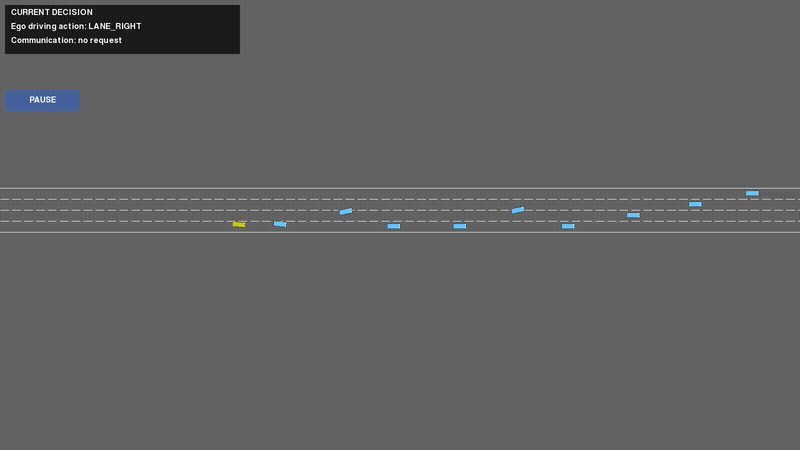
</a>

[Open the DQN policy video directly](https://raw.githubusercontent.com/YashKhairnar/Echo/main/docs/images/dqn_1000_policy.mp4)

### Training graphs

<table>
  <tr>
    <td>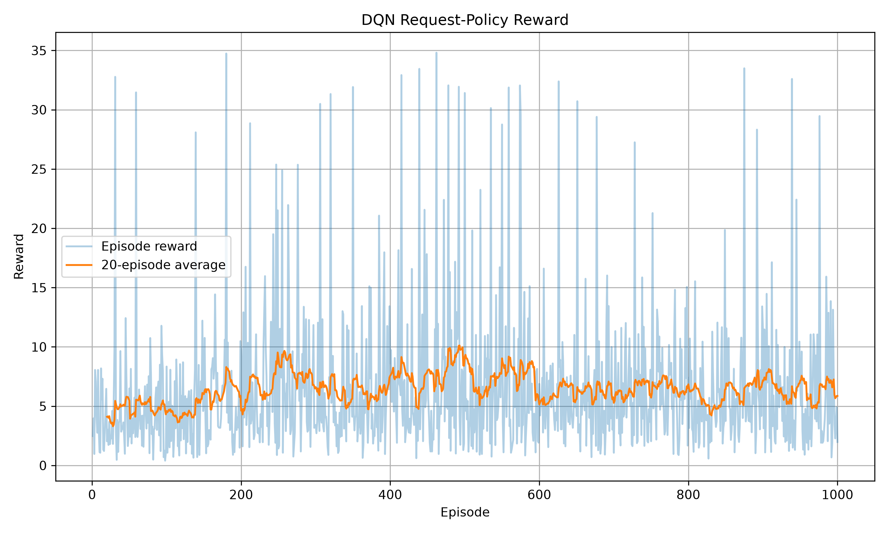</td>
    <td>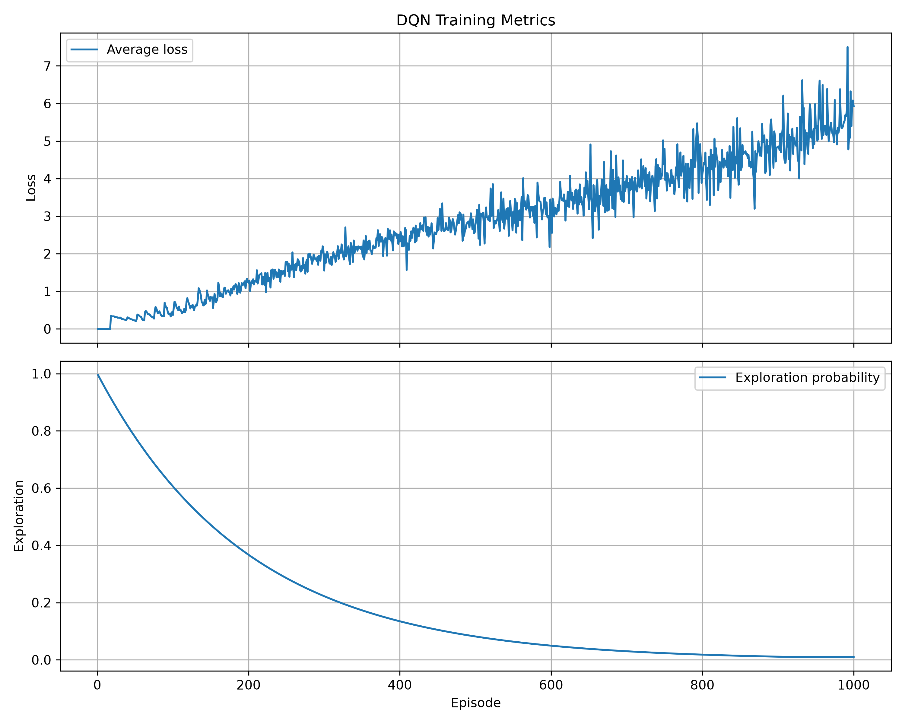</td>
  </tr>
  <tr>
    <td>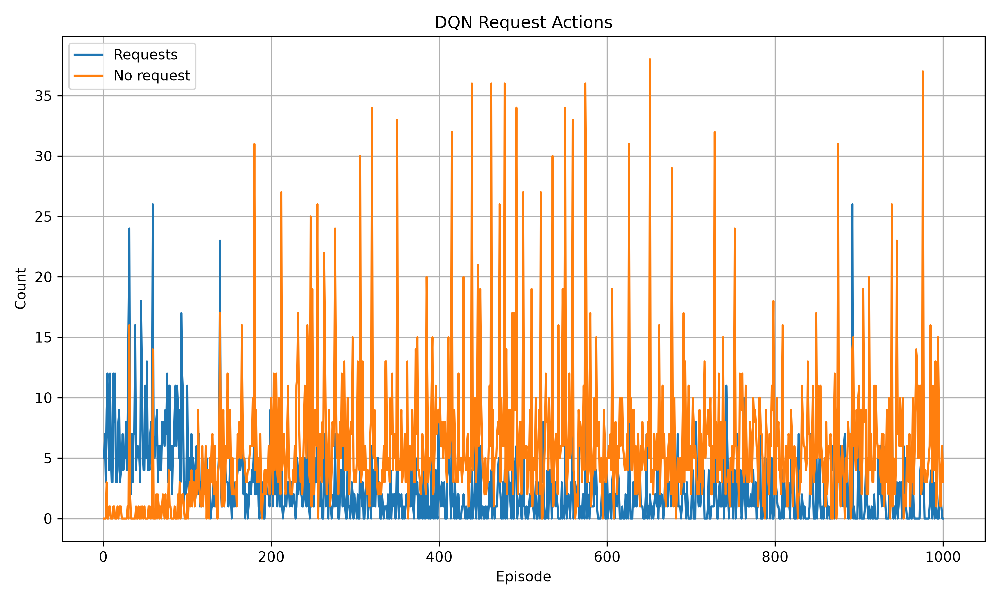</td>
    <td>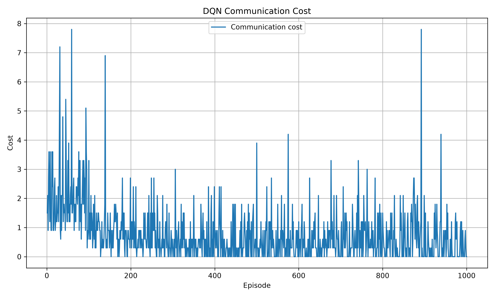</td>
  </tr>
</table>

</details>

<details>
<summary><strong>Experiment 2 — DQN resumed training (1,000 → 2,000 episodes)</strong></summary>

The resumed run achieved an average reward of `8.67`, compared with `6.42` for the previous 1000-episode run. Communication cost decreased as the policy requested information less often. The run is stored under:

```text
archive/legacy_single_request/results/DQN/
```

The reward improved, but the DQN loss remained unstable, so the policy should be evaluated against a no-request baseline before drawing final conclusions.

### Supporting MLP world model

The second archived MLP run also trained for `50` epochs. Its best test loss
was approximately `0.4044` at epoch `42`, and its final test loss was `0.4117`:

| Final test state loss | Final test reward loss | Final test loss |
| ---: | ---: | ---: |
| 0.3827 | 0.0290 | 0.4117 |

The archived metrics are in `archive/legacy_single_request/results/MLP/mlp_training_1.csv`. The best MLP
checkpoint should be used when reproducing the resumed DQN experiment.

[Read the resumed-experiment notes](docs/dqn_resume_1000_2000.md)

<a href="https://raw.githubusercontent.com/YashKhairnar/Echo/main/docs/images/dqn_resume_1000_2000_policy.mp4">
  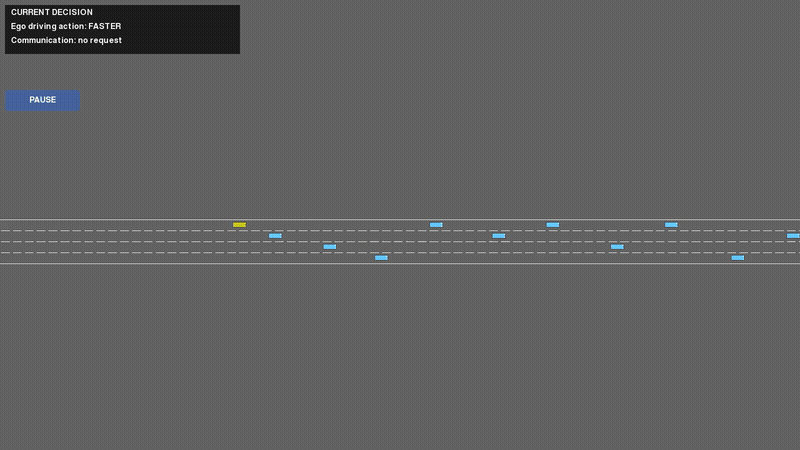
</a>

[Open the resumed-policy video directly](https://raw.githubusercontent.com/YashKhairnar/Echo/main/docs/images/dqn_resume_1000_2000_policy.mp4)

### Training graphs

<table>
  <tr>
    <td>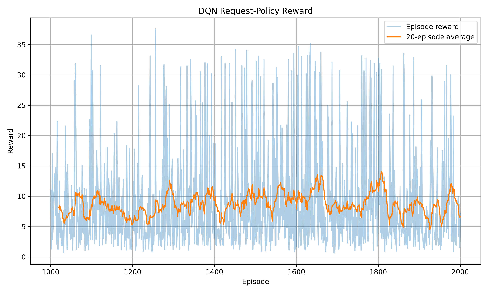</td>
    <td>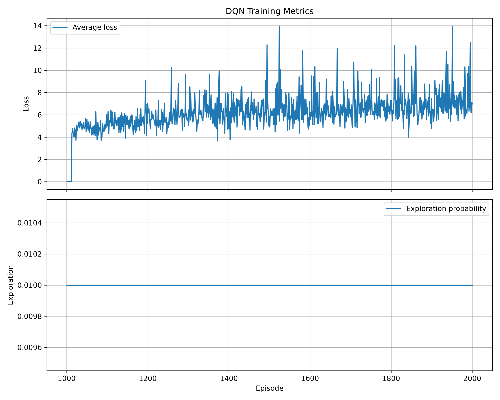</td>
  </tr>
  <tr>
    <td>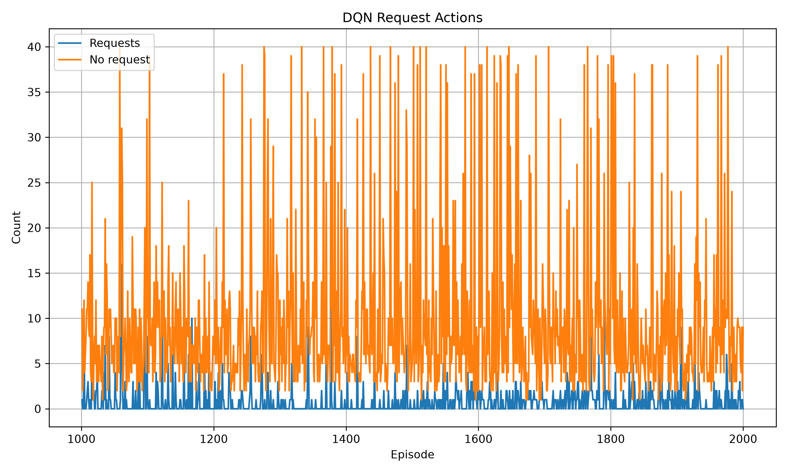</td>
    <td>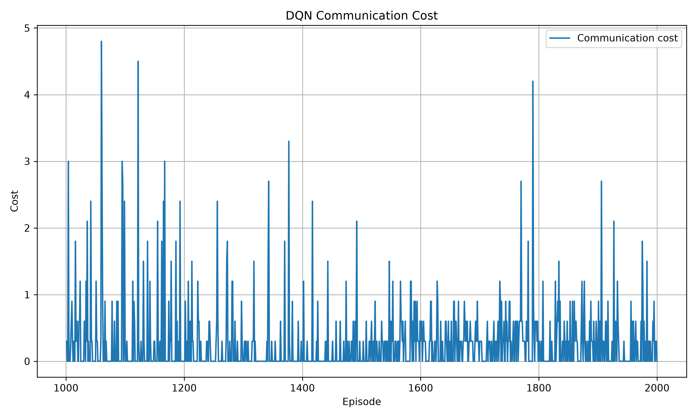</td>
  </tr>
</table>

</details>

<details>
<summary><strong>Experiment 3 — MLPx + DQNx multi-request communication</strong></summary>

This experiment extends the original request policy so the ego vehicle can
request information from multiple visible neighboring vehicles at the same
timestep. MLPx predicts the next observation and reward from the current
observation, driving action, request mask, and received messages. DQNx chooses
the request mask, while the five-step MCP planner uses MLPx to choose the
driving action.

The recorded DQNx run used:

- `2,000` episodes;
- ten request slots with visibility masking;
- a `0.3` communication cost per requested vehicle;
- real environment transitions for DQNx training; and
- MLPx plus five-step MCP planning for the driving action.

The current training script uses a `0.1` communication cost, so this value
must be checked when comparing new runs with the recorded experiment.

### MLPx results

The best MLPx test losses were approximately:

| Run | Epochs | Best test loss | Best epoch |
| --- | ---: | ---: | ---: |
| `20261112_132150_mlpx` | 100 | 0.4292 | 30 |
| `20261112_132315_mlpx` | 200 | 0.4329 | 24 |

The second run became worse after its early best epoch, suggesting overfitting
or limited data diversity. The `best.pt` checkpoint should be used for planning.

### DQNx results

For the final 100 episodes of the recorded run:

- mean reward: approximately `10.93`;
- mean DQNx loss: approximately `5.02`;
- mean requests: `0.82` per episode; and
- mean communication cost: approximately `0.246`.

The policy often selected no requests. This lowers communication cost, but it
must be compared against no-request and random-request baselines before being
considered successful communication learning.

The archived training artifacts are stored under
`archive/pre_ttc_multirequest/results/MLPx/experiments/` and
`archive/pre_ttc_multirequest/results/DQNx/experiments/`, with new active
checkpoints in `checkpoints/MLPx/` and `checkpoints/DQNx/`.

[Read the DQNx documentation](docs/dqnx_request_policy.md)

<a href="https://raw.githubusercontent.com/YashKhairnar/Echo/main/docs/images/dqnx_current_policy.mp4">
  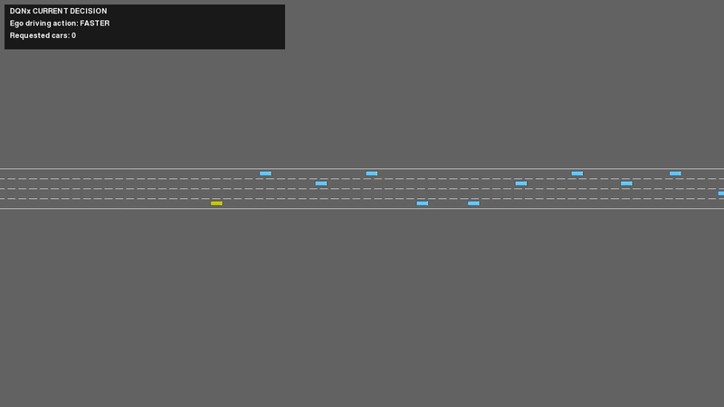
</a>

[Open the current DQNx policy video](docs/images/dqnx_current_policy.mp4)

</details>
