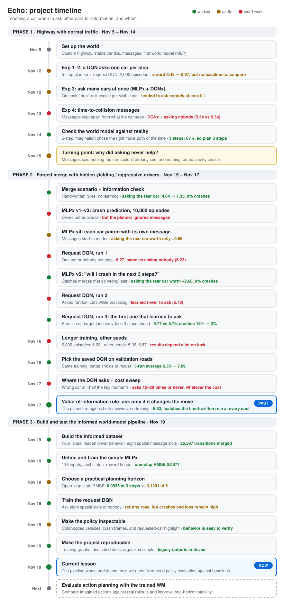

# Echo: Cooperative Driving

A self-driving car learns **when to ask nearby cars for information, and whom
to ask**. Every request can cost something, so it should only ask when the
answer can change how it drives. Built on
[HighwayEnv](https://github.com/Farama-Foundation/HighwayEnv).

## Active scenario

The active environment has four lanes, one controlled ego vehicle, and ten
background vehicles. Background traffic uses HighwayEnv's aggressive and
defensive behavior classes. Vehicles have stable IDs, and the ego can inspect
up to eight nearby spatial slots within 60 m: left-front, left-beside,
left-rear, same-lane-front, same-lane-rear, and the corresponding right-lane
slots.

The older hidden-driver merge scenario is preserved in the documentation
archive as historical experiment material.

## The main parts

| Part | Job | Code |
| --- | --- | --- |
| **CustomEnv** | Creates the four-lane scene, vehicle types, IDs, visibility, and intent previews | `src/cooperative_driving/environments/customEnv.py` |
| **MLPx** (world model) | Predicts the next observation and reward from the current state, ego action, and ordered vehicle messages | `src/cooperative_driving/models/MLPx/mlpx.py` |
| **Planner** | Imagines three steps for each candidate ego action and picks the best one | `src/cooperative_driving/planner/MCP.py` |
| **Data-collection policy** | Uses visible neighbors and requested intents to choose one of five ego actions | `scripts/policy/intent_aware_policy.py` |
| **Request DQN** | Chooses one of eight vehicle slots or asks nobody | `src/cooperative_driving/policies/request_dqn.py` |
| **Renderer** | Shows the learned request policy, vehicle types, crashes, and requested vehicles | `scripts/evaluation/render_request_dqn.py` |

## Current snapshot

| Item | Current state |
| --- | --- |
| Combined dataset | Experiment 3: 263,375 transitions, including 65,822 no-message records |
| MLPx input | 116 values: 55 state, 5 ego-action, and 56 message values |
| MLPx output | 55-value next state plus reward |
| Planner horizon | Three steps |
| Request DQN actions | Eight spatial request slots plus ask-nobody |
| Active checkpoints | `checkpoints/experiment_3/{MLPx,RequestDQN}/` |
| Selected DQN | Fixed spatial actions, 1,000 episodes; 2,000-episode continuation retained |

Experiment 3 MLPx achieved three-step action agreement of 81.61% without
messages and 81.94% with all visible messages over 299 sampled states per
group using the corrected evaluator. See the model docs for errors and limits.

On the same 200 evaluation seeds, the selected Experiment 3 DQN achieved
return 15.585 and 88% crashes, versus Experiment 1's 14.955 and 92%.
It sends more requests (7.015 versus 5.040 per episode). Its no-request baseline
already crashes at 88.5%, so a reliable safety benefit from communication is
not established. The 2,000-episode continuation performed worse (15.142 return,
90.5% crashes); the 1,000-episode model was restored for inference.

## Project timeline

<a href="https://yashkhairnar.github.io/Echo/timeline.html"></a>

[Open the interactive timeline](https://yashkhairnar.github.io/Echo/timeline.html) directly.

## Run it

```bash
# Render the selected Experiment 3 policy (requires local checkpoints)
.venv/bin/python -m scripts.evaluation.render_request_dqn \
  --experiment 3 --episodes 1 --seed 10

# Rebuild the HTML documentation site
.venv/bin/python -m scripts.docs.build_docs_site
```

Follow [Training](docs/training.html) for collection, training, resume, and
evaluation commands. Datasets and checkpoints are local generated artifacts
and are excluded from Git. The active best.pt is the selected 1,000-episode
model; latest.pt retains the 2,000-episode training state for resuming.

## Docs

- [docs/index.html](docs/index.html): HTML documentation site
- [docs/mlpx.html](docs/mlpx.html): MLPx world-model definition and evaluation
- [docs/planner.html](docs/planner.html): three-step model-predictive planner
- [docs/policy.html](docs/policy.html): rule-based data-collection policy
- [docs/dqn_policy.html](docs/dqn_policy.html): learned Request DQN policy
- [docs/rendering.html](docs/rendering.html): renderer controls, colors, and highlights
- [docs/training.html](docs/training.html): collection, training, resume, and evaluation run guide
- [docs/intent_aware_data_collection.html](docs/intent_aware_data_collection.html): current vehicle, intent, rule, and dataset workflow
- [docs/dataset_dashboard.html](docs/dataset_dashboard.html): dataset statistics dashboard
- [docs/progress_log.html](docs/progress_log.html): dated log of what was done
- [docs/archive/](docs/archive/): earlier highway and merge experiments

## Publish the docs

The repository includes a GitHub Pages workflow at
`.github/workflows/deploy-docs.yml`. In the repository settings, set
**Pages → Build and deployment → Source** to **GitHub Actions**. Every push to
`main` then publishes the `docs/` folder at:

<https://yashkhairnar.github.io/Echo/>
