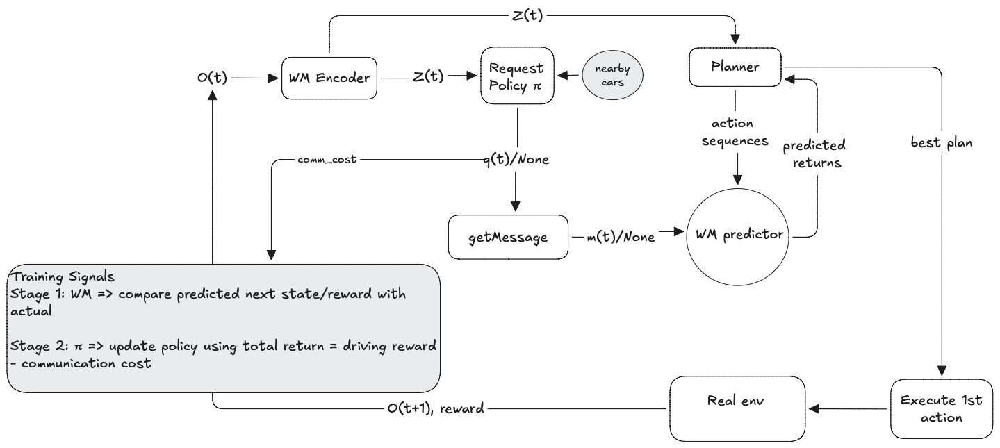

# Cooperative Driving

This project explores cooperative driving with HighwayEnv, where multiple vehicles interact on a highway. Each vehicle shares information about its intended acceleration, steering, and lane changes with nearby vehicles. This shared information helps represent cooperation between vehicles and provides data for training a world model to predict future traffic states and rewards.

