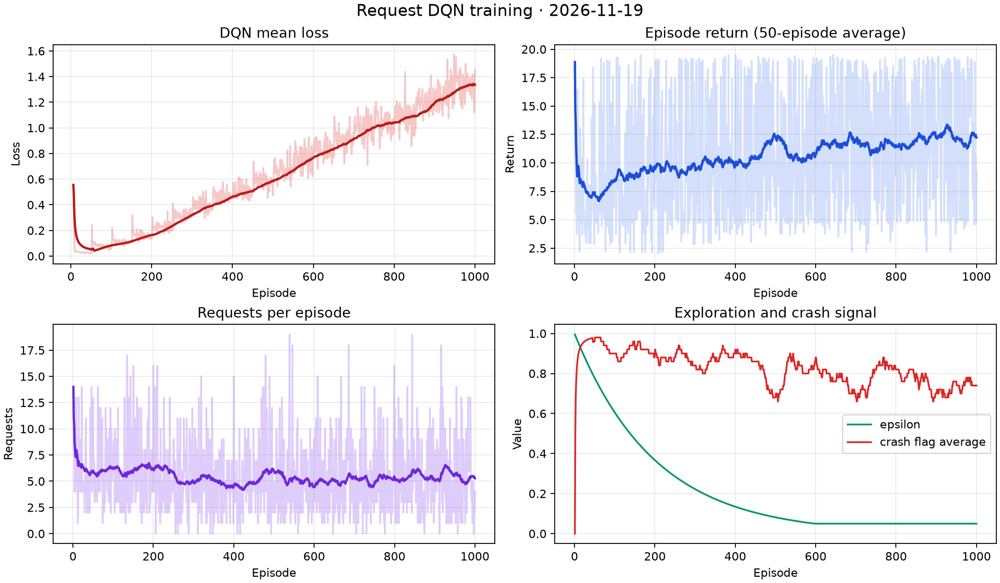
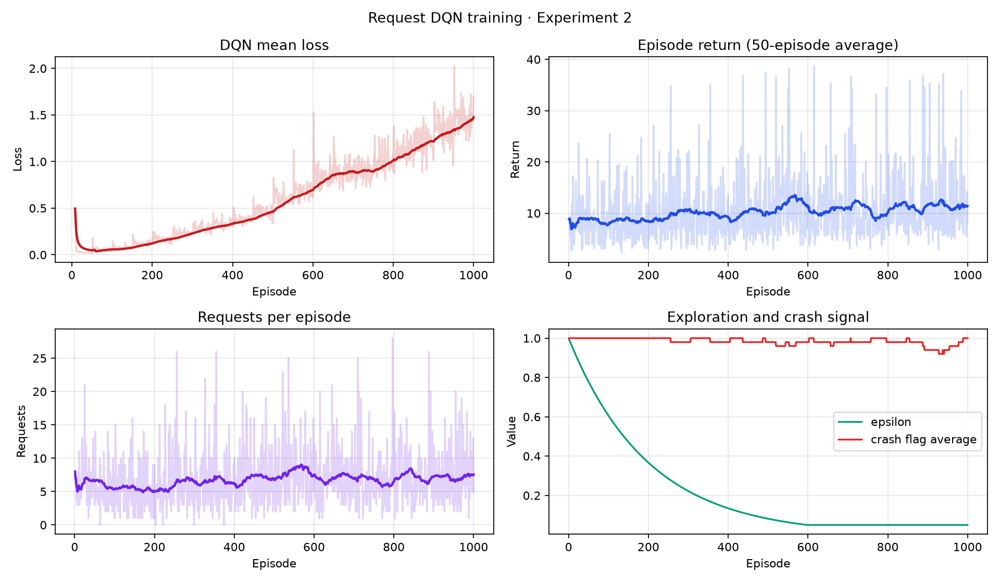
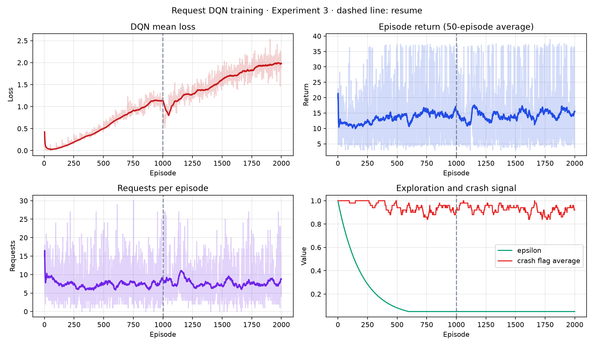

# Request DQN policy

The Request DQN is a learned communication policy. It decides **which visible
vehicle to ask**, or whether to ask nobody. It does not directly choose the
ego's driving action.

After the DQN selects a request, the frozen MLPx planner uses the returned
message to choose the ego action with a three-step planning horizon.

## Shared policy design

### Request actions

The DQN has nine possible actions:

```text
left-front, left-beside, left-rear,
same-lane-front, same-lane-rear,
right-front, right-beside, right-rear,
ask-nobody
```

Invalid spatial slots are masked during action selection. The DQN receives a
45-value state representation containing the ego and eight ordered neighbor
slots.

| Action | Fixed request target |
| ---: | --- |
| 0 | Left-front |
| 1 | Left-beside |
| 2 | Left-rear |
| 3 | Same-lane-front |
| 4 | Same-lane-rear |
| 5 | Right-front |
| 6 | Right-beside |
| 7 | Right-rear |
| 8 | Ask nobody |

Newly trained DQNs store `request_action_encoding: spatial_v1`. Empty slots
are masked for exploration, greedy selection, and next-state target values.
Request resolution, message placement, and the renderer use the same mapping.

This action-mapping correction was made after the first Experiment 3 DQN run. The earlier fix
aligned World Model message slots, but DQN actions still indexed the compressed
list of visible vehicles. Experiment 1/2 and the first Experiment 3 DQN run
retain their original `compressed_v0` actions when loaded, with an explicit
warning. The latest Experiment 3 DQN was retrained with `spatial_v1` actions,
reusing the frozen Experiment 3 MLPx checkpoint without recollecting data.

### Training setup

```text
DQN reward = real driving reward - communication cost when a vehicle is asked
```

The DQN uses replay memory, an online Q-network, a target Q-network,
epsilon-greedy exploration, and Huber loss. The target network is synchronized
every 50 episodes. Each experiment has its own checkpoint and result folder.

Training supports `--resume` for additional episodes. New `latest.pt` files
contain full training state; older weights-only checkpoints support partial
continuation with a warning. See [Training](training.html) for commands and
the resume/checkpoint behavior. More episodes do not guarantee higher return
or lower DQN loss; compare continued checkpoints on the same evaluation seeds.

## Experiment 1 · Baseline request policy

### Setup

Completed 1,000 training episodes using the frozen Experiment 1 MLPx checkpoint. The DQN selects requests and the planner selects driving actions.

### Configuration

Three-step planner · communication cost 0.05 per requested message · nine request actions · replay memory · Huber loss · target synchronization every 50 episodes.

### Commands

```bash
.venv/bin/python -m scripts.training.train_request_dqn \
  --experiment 1 --episodes 1000 \
  --planning-horizon 3 --communication-cost 0.05
```

### Results

| Metric | Result |
| --- | ---: |
| Episodes | `1,000` |
| Mean return | `10.621` |
| Mean return, last 100 episodes | `12.167` |
| Best episode return | `19.526` at episode `643` |
| Mean training loss | `0.655` |
| Mean loss, last 100 episodes | `1.307` |
| Mean requests per episode | `5.392` |
| Mean requests, last 100 episodes | `5.460` |
| Episodes with crash flag | `826` (`82.60%`) |
| Episodes with truncation flag | `200` (`20.00%`) |
| Final epsilon | `0.05` |

The baseline shows improving late returns, but the crash rate and late loss
remain high. It is useful as a first communication-policy checkpoint, not as a
reliable deployment policy. The Experiment 1 log contains 26 episodes with
both flags, so the crash and truncation percentages are reported independently
and are not mutually exclusive.

### Graphs



#### Policy rendering

Recorded with **seed 10**, the Experiment 1 MLPx checkpoint, and the Experiment 1 DQN. All three experiment recordings use the same current environment configuration, a three-step planner, an 1800×800 frame, and two frames per second.

| Metric | Result |
| --- | ---: |
| Steps completed | `15 / 40` |
| Outcome | Crashed |
| Driving reward | `12.769` |
| Requests sent | `5` |

The overlay shows the requested vehicle ID, exact response, and ego action.
A yellow circle identifies the requested vehicle. This historical DQN retains its original compressed-action interpretation.

```bash
SDL_VIDEODRIVER=dummy .venv/bin/python -m scripts.evaluation.render_request_dqn \
  --experiment 1 \
  --episodes 1 --seed 10 --delay 0 \
  --planning-horizon 3 --video-fps 2 \
  --video docs/images/dqn_experiment_1_seed10.mp4
```


This is one illustrative episode; the 200-episode evaluation below describes
broader performance. The [earlier seed-7 recording](images/dqn_experiment_1_policy.mp4)
is retained separately.

### Evaluation

Evaluation compared the learned request policy against no-request,
random-request, and ask-all baselines over 200 episodes each, starting at seed
`100000`, with communication cost `0.05`:

```bash
.venv/bin/python -m scripts.evaluation.evaluate_request_dqn \
  --experiment 1 \
  --episodes 200 \
  --planning-horizon 3
```

| Request policy | Mean return | Mean driving reward | Mean requests per episode | Crashes | Crash rate | Truncations |
| --- | ---: | ---: | ---: | ---: | ---: | ---: |
| DQN | `14.955` | `15.207` | `5.040` | `184 / 200` | `92.00%` | `16` |
| Ask nobody | `13.070` | `13.070` | `0.000` | `198 / 200` | `99.00%` | `2` |
| Random requests | `6.941` | `7.359` | `8.355` | `200 / 200` | `100.00%` | `0` |
| Ask all visible | `4.331` | `4.959` | `12.560` | `200 / 200` | `100.00%` | `0` |

The DQN improves mean return over ask-nobody by `1.884` (about `14.41%`)
and reduces crashes by 14 episodes, or `7` percentage points. This evaluation
provides evidence that the learned request strategy helps the Experiment 1
system relative to its no-request baseline. The remaining `92%` crash rate is
still high, and uncertainty across independent training runs has not been
measured.

Results are saved under `results/experiment_1/evaluation/request_dqn/`.

### Artifacts

Checkpoint: `checkpoints/experiment_1/RequestDQN/best.pt`.

Training log: `results/experiment_1/RequestDQN/experiments/20261119_113503_request_dqn/request_dqn_training.csv`.

Evaluation CSV and JSON: `results/experiment_1/evaluation/request_dqn/`.

### Notes

These results predate the corrected spatial message encoding and masked next-request training targets. Preserve them as historical baselines. The high crash rate remains unresolved.

## Experiment 2 · Larger World Model request policy

### Setup

Completed 1,000 training episodes using the frozen Experiment 2 MLPx checkpoint. The DQN selects requests and the planner selects driving actions.

### Configuration

Three-step planner · communication cost 0.05 per requested message · nine request actions · replay memory · Huber loss · target synchronization every 50 episodes.

### Commands

```bash
.venv/bin/python -m scripts.training.train_request_dqn \
  --experiment 2 --episodes 1000 \
  --planning-horizon 3 --communication-cost 0.05
```

### Results

| Metric | Result |
| --- | ---: |
| Episodes | `1,000` |
| Mean return | `10.263` |
| Mean return, last 100 episodes | `11.423` |
| Best episode return | `38.658` at episode `615` |
| Mean training loss | `0.618` |
| Mean loss, last 100 episodes | `1.407` |
| Mean requests per episode | `6.749` |
| Mean requests, last 100 episodes | `7.190` |
| Episodes with crash flag | `984` (`98.40%`) |
| Episodes with truncation flag | `16` (`1.60%`) |
| Final epsilon | `0.05` |

The return in the last 100 episodes was higher than the overall average, but
the very high crash rate and rising late-training loss show that this
checkpoint is not yet reliable. Request frequency also remains substantial,
so the policy has not yet demonstrated efficient communication.

### Graphs



#### Policy rendering

Recorded with **seed 10**, the Experiment 2 MLPx checkpoint, and the Experiment 2 DQN. All three experiment recordings use the same current environment configuration, a three-step planner, an 1800×800 frame, and two frames per second.

| Metric | Result |
| --- | ---: |
| Steps completed | `8 / 40` |
| Outcome | Crashed |
| Driving reward | `6.790` |
| Requests sent | `1` |

The overlay shows the requested vehicle ID, exact response, and ego action.
A yellow circle identifies the requested vehicle. This historical DQN retains its original compressed-action interpretation.

```bash
SDL_VIDEODRIVER=dummy .venv/bin/python -m scripts.evaluation.render_request_dqn \
  --experiment 2 \
  --episodes 1 --seed 10 --delay 0 \
  --planning-horizon 3 --video-fps 2 \
  --video docs/images/dqn_experiment_2_seed10.mp4
```


This is one illustrative episode; the 200-episode evaluation below describes
broader performance. The [earlier seed-7 recording](images/dqn_experiment_2_policy.mp4)
is retained separately.

### Evaluation

Evaluation compared four policies on 200 episodes each, starting at seed
`100000`, with a three-step planning horizon and communication cost `0.05`:

```bash
.venv/bin/python -m scripts.evaluation.evaluate_request_dqn \
  --experiment 2 \
  --episodes 200 \
  --planning-horizon 3
```

| Request policy | Mean return | Mean driving reward | Mean requests per episode | Crashes | Crash rate | Truncations |
| --- | ---: | ---: | ---: | ---: | ---: | ---: |
| DQN | `12.326` | `12.556` | `4.615` | `189 / 200` | `94.50%` | `11` |
| Ask nobody | `11.973` | `11.973` | `0.000` | `186 / 200` | `93.00%` | `14` |
| Random requests | `7.692` | `8.144` | `9.050` | `199 / 200` | `99.50%` | `1` |
| Ask all visible | `6.855` | `7.705` | `16.985` | `200 / 200` | `100.00%` | `0` |

Return includes the communication penalty; driving reward excludes it. Request
counts are messages sent per episode, so ask-all can send multiple messages
in one step.

The DQN has the highest mean return, exceeding ask-nobody by `0.352`
(about `2.94%`), while sending fewer requests than random or ask-all.
However, it crashes in three more episodes than ask-nobody, a difference of
`1.5` percentage points. This run shows a small average return advantage,
but no safety advantage from communication. Statistical uncertainty has not
been quantified, so the return difference alone does not establish a reliable
improvement.

All four policies crash in at least 93% of episodes. The shared driving planner
and World Model need investigation alongside the request policy; these results
do not isolate which component causes the failures.

The evaluation CSV and JSON summary are saved under
`results/experiment_2/evaluation/request_dqn/`.

### Artifacts

Checkpoint: `checkpoints/experiment_2/RequestDQN/best.pt`.

Training log: `results/experiment_2/RequestDQN/experiments/20261119_170031_request_dqn/request_dqn_training.csv`.

Evaluation CSV and JSON: `results/experiment_2/evaluation/request_dqn/`.

### Notes

These results predate the corrected spatial message encoding and masked next-request training targets. Preserve them as historical baselines. The high crash rate remains unresolved.

## Experiment 3 · Corrected request-policy training

### Setup

Completed 2,000 cumulative episodes with fixed spatial request actions: 1,000
initial episodes followed by 1,000 additional episodes. The frozen Experiment
3 MLPx checkpoint is unchanged. Earlier training runs remain available.

### Configuration

Three-step planner · communication cost 0.05 · frozen Experiment 3 MLPx · valid next-request masking in DQN targets · request_action_encoding: spatial_v1.

### Commands

```bash
.venv/bin/python -m scripts.training.train_request_dqn \
  --experiment 3 --episodes 1000 \
  --planning-horizon 3 --communication-cost 0.05
```

Continue the fixed-action checkpoint for another 1,000 episodes:

```bash
.venv/bin/python -m scripts.training.train_request_dqn \
  --experiment 3 --resume --episodes 1000 --save-every 50
```

### Results

| Metric | Previous DQN (compressed actions) | Initial fixed-action DQN (1,000 episodes) |
| --- | ---: | ---: |
| Episodes | `1,000` | `1,000` |
| Mean return | `13.475` | `13.379` |
| Mean return, last 100 episodes | `14.366` | `14.749` |
| Best episode return | `38.804` at episode `529` | `37.375` at episode `780` |
| Mean training loss | `0.563` | `0.572` |
| Mean loss, last 100 episodes | `1.136` | `1.137` |
| Mean requests per episode | `7.310` | `7.404` |
| Mean requests, last 100 episodes | `7.300` | `7.810` |
| Episodes with crash flag | `945` (`94.50%`) | `949` (`94.90%`) |
| Episodes with truncation flag | `60` (`6.00%`) | `54` (`5.40%`) |
| Final epsilon | `0.05` | `0.05` |

The table above records the initial 1,000-episode runs. The fixed-action run
has three episodes with both flags; the compressed-action run has five.

| Metric | Continuation: episodes 1,001–2,000 |
| --- | ---: |
| Additional episodes | `1,000` |
| Cumulative episodes completed | `2,000` |
| Mean return | `14.392` |
| Mean return, last 100 episodes | `15.678` |
| Best episode return | `38.944` at episode `1,791` |
| Mean training loss | `1.577` |
| Mean loss, last 100 episodes | `1.982` |
| Mean requests per episode | `7.782` |
| Mean requests, last 100 episodes | `8.080` |
| Episodes with crash flag | `926` (`92.60%`) |
| Episodes with truncation flag | `75` (`7.50%`) |
| Final epsilon | `0.05` |
| Saved replay transitions | `16,217` |

The continuation has one episode with both flags. Percentages use the 1,000
additional episodes, and return includes communication cost. The first
continuation loaded weights only, so optimizer, replay, and random states
restarted. The new latest.pt now contains full resumable state.
The active checkpoint confirms both
`masked_next_request_targets: True` and `request_action_encoding: spatial_v1`.

### Graphs



The four panels match Experiments 1 and 2: loss, return, requests, and
epsilon/crash signal. Faint curves show individual episodes; solid curves
show trailing averages over up to 50 episodes.

The graph combines the initial fixed-action run (episodes 1–1,000) with its
continuation (1,001–2,000). A dashed line marks the resume boundary after
episode 1,000. The earlier compressed-action run is excluded. Smoothing uses
trailing windows of up to 50 episodes across the combined history. This first
continuation restarted optimizer/replay state, as described under Results.

#### Policy rendering

Recorded with **seed 10**, the Experiment 3 MLPx checkpoint, and the selected 1,000-episode fixed-action DQN. All three experiment recordings use the same current environment configuration, a three-step planner, an 1800×800 frame, and two frames per second.

| Metric | Result |
| --- | ---: |
| Steps completed | `10 / 40` |
| Outcome | Crashed |
| Driving reward | `8.594` |
| Requests sent | `6` |

The overlay shows the requested vehicle ID, exact response, and ego action.
A yellow circle identifies the requested vehicle. This recording uses the selected 1,000-episode model, rather than the 2,000-episode continuation.

```bash
SDL_VIDEODRIVER=dummy .venv/bin/python -m scripts.evaluation.render_request_dqn \
  --experiment 3 \
  --dqn-checkpoint results/experiment_3/RequestDQN/experiments/20261119_225244_request_dqn/best.pt \
  --episodes 1 --seed 10 --delay 0 \
  --planning-horizon 3 --video-fps 2 \
  --video docs/images/dqn_experiment_3_seed10.mp4
```


This is one illustrative episode; the 200-episode evaluation below describes
broader performance. The [earlier seed-7 recording](images/dqn_experiment_3_policy.mp4)
is retained separately.

### Evaluation

The 2,000-episode checkpoint evaluation is complete. The saved summary confirms
`request_action_encoding: spatial_v1`: 200 episodes per policy, starting at
seed `100000`, with a three-step planner and communication cost `0.05`.
DQN evaluation uses greedy requests.

Reproduce the 2,000-episode evaluation with its explicit run checkpoint:

```bash
.venv/bin/python -m scripts.evaluation.evaluate_request_dqn \
  --experiment 3 --episodes 200 --planning-horizon 3 \
  --dqn-checkpoint results/experiment_3/RequestDQN/experiments/20261119_230820_request_dqn/best.pt
```

The table below shows the latest 2,000-episode checkpoint. Its evaluation
replaced the pre-continuation files in the default output folder. The earlier
reported aggregate results are retained in the comparison below.

| Request policy | Mean return | Mean driving reward | Mean requests per episode | Crashes | Crash rate | Truncations |
| --- | ---: | ---: | ---: | ---: | ---: | ---: |
| DQN | `15.142` | `15.515` | `7.460` | `181 / 200` | `90.50%` | `21` |
| Ask nobody | `14.092` | `14.092` | `0.000` | `177 / 200` | `88.50%` | `23` |
| Random requests | `9.216` | `9.759` | `10.855` | `199 / 200` | `99.50%` | `1` |
| Ask all visible | `6.047` | `6.867` | `16.385` | `200 / 200` | `100.00%` | `0` |

Return includes communication cost; driving reward excludes it. The DQN
improves mean return over asking nobody by `1.050` (about `7.45%`) but crashes
in four additional episodes, a `2` percentage-point increase. It requests less
often than random or ask-all. Crash and truncation flags can overlap.

| Metric | Fixed-action DQN: 1,000 episodes | Fixed-action DQN: 2,000 episodes |
| --- | ---: | ---: |
| Mean return | `15.585` | `15.142` |
| Mean driving reward | `15.936` | `15.515` |
| Mean requests per episode | `7.015` | `7.460` |
| Crashes | `176 / 200` | `181 / 200` |
| Crash rate | `88.00%` | `90.50%` |
| Truncation flags | `25` | `21` |

On the same 200 evaluation seeds, the continuation has lower return, five
more crashes, and more requests. The 1,000-episode fixed-action checkpoint
remains the better observed checkpoint. Statistical uncertainty has not been
quantified; this single continuation does not show that more training helped.

### Artifacts

Active inference checkpoint: `checkpoints/experiment_3/RequestDQN/best.pt`
is the selected 1,000-episode fixed-action model from run
`20261119_225244_request_dqn`.

Latest continuation log: `results/experiment_3/RequestDQN/experiments/20261119_230820_request_dqn/request_dqn_training.csv`.

Initial fixed-action run:
`results/experiment_3/RequestDQN/experiments/20261119_225244_request_dqn/`.

Previous training log and checkpoint:
`results/experiment_3/RequestDQN/experiments/20261119_223432_request_dqn/`.

Run checkpoint: `best.pt` in the same run directory. The trainer saves the
final online network under this filename; it does not select the best
validation episode.

Resumable state: `checkpoints/experiment_3/RequestDQN/latest.pt` and the
continuation run's `latest.pt`.

Latest 2,000-episode evaluation CSV and JSON:
`results/experiment_3/evaluation/request_dqn/`.

### Notes

Last-100 return rose from 14.749 before continuation to 15.678 afterward,
but last-100 loss also rose from 1.137 to 1.982. Training crashes remain
frequent. Despite higher late-training return, the continuation's greedy
evaluation is worse on return, requests, and crash rate. Prefer the original
fixed-action run's checkpoint for the next comparison; it is preserved at
`results/experiment_3/RequestDQN/experiments/20261119_225244_request_dqn/best.pt`.
The 1,000-episode model has been restored as the active inference checkpoint.
The 2,000-episode model remains preserved in run
`20261119_230820_request_dqn/best.pt`. The resumable `latest.pt` still contains
the 2,000-episode training state: plain `--resume` continues that state.
To branch training from the selected policy, pass its explicit checkpoint
path with `--resume`; that weights-only file restarts optimizer/replay state.

## Same-seed video comparison

All recordings above start from seed `10` using the same current four-lane,
40-second environment configuration and render settings. Each experiment
uses its own trained World Model and DQN. Experiment 3 uses its selected
1,000-episode fixed-action DQN.

| Experiment | Seed | Steps completed | Outcome | Driving reward | Requests |
| --- | ---: | ---: | --- | ---: | ---: |
| 1 | `10` | `15 / 40` | Crashed | `12.769` | `5` |
| 2 | `10` | `8 / 40` | Crashed | `6.790` | `1` |
| 3 (selected 1,000-episode DQN) | `10` | `10 / 40` | Crashed | `8.594` | `6` |

Experiment 1 lasts longest on this particular seed. All three crash, showing
why a single video cannot establish overall policy quality. Playback uses one
frame per decision plus the final scene, rather than intermediate physics frames.

## Comparison across experiments

All three evaluations used 200 episodes starting at seed `100000`, a three-step
planner, and communication cost `0.05`. Each experiment used its own MLPx and
DQN checkpoints, so this compares the complete systems rather than isolating
the DQN or the World Model.

Both fixed-action Experiment 3 checkpoints are shown to preserve the
pre-continuation comparison.

| Metric | Experiment 1 DQN | Experiment 2 DQN | Experiment 3: 1,000 episodes | Experiment 3: 2,000 episodes |
| --- | ---: | ---: | ---: | ---: |
| Mean return | `14.955` | `12.326` | `15.585` | `15.142` |
| Mean requests per episode | `5.040` | `4.615` | `7.015` | `7.460` |
| Crash rate | `92.00%` | `94.50%` | `88.00%` | `90.50%` |
| Return gain over own no-request baseline | `1.884` | `0.352` | `1.493` | `1.050` |
| Crash-rate reduction versus own no-request baseline | `7.0` percentage points | `-1.5` percentage points | `0.5` percentage points | `-2.0` percentage points |

Experiment 3's 1,000-episode fixed-action checkpoint has the highest mean
return and the lowest observed DQN crash rate. Its crash rate is 4 percentage
points below Experiment 1 and 6.5 points below Experiment 2. Experiment 1 has the larger
observed safety advantage over its own no-request baseline. Multiple training
seeds and uncertainty estimates are needed before attributing the differences
to specific changes.

Relative to Experiment 1, the selected Experiment 3 system has about 4.2%
higher return and eight fewer crashes across these 200 seeds, at the cost of
more communication. This is modest observed complete-system progress; the
learned communication strategy itself has not shown a stronger safety benefit.
Seed 10 favors Experiment 1, illustrating variation across individual scenes.
