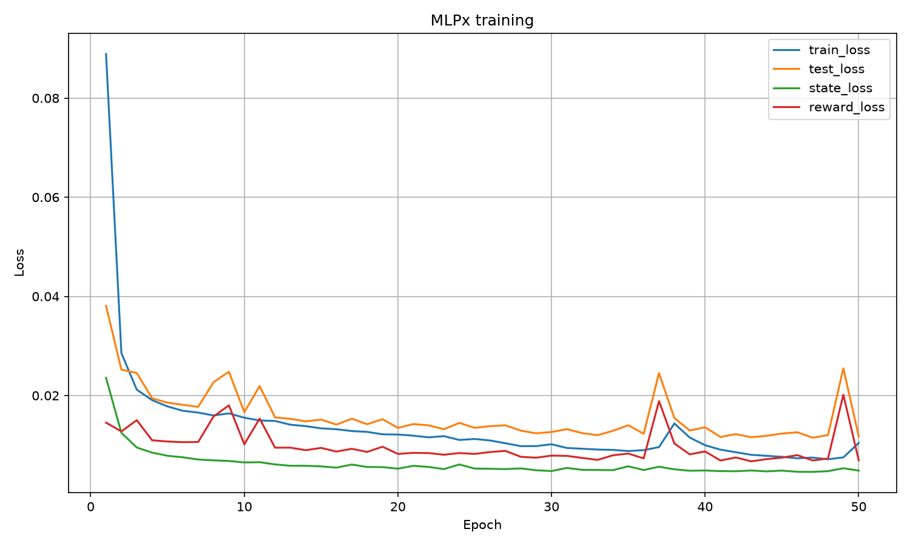
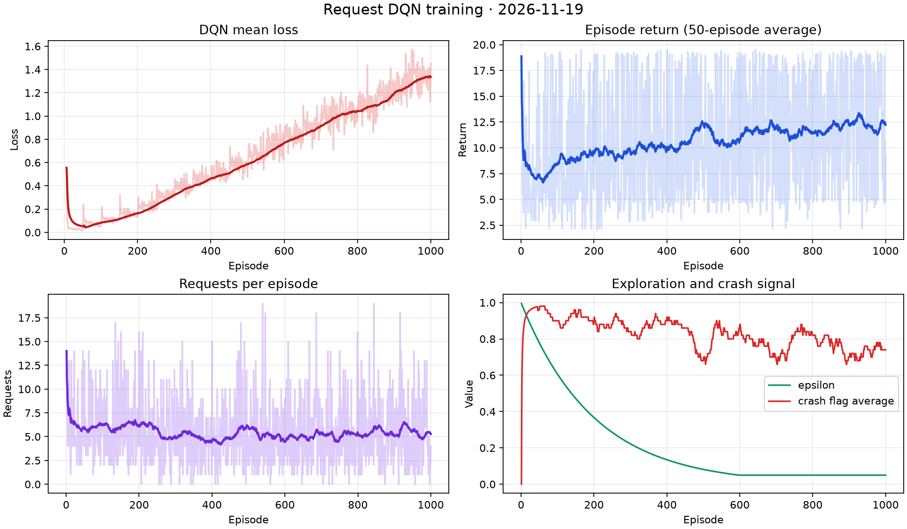

# Experiment 1: Baseline Integration

**Experiment 1** is the initial proof-of-concept pipeline connecting Farama's HighwayEnv, the neural World Model (**MLPx**), and the learned communication policy (**Request DQN**).

- **World Model Checkpoint:** `checkpoints/experiment_1/MLPx/best.pt`
- **Request DQN Checkpoint:** `checkpoints/experiment_1/RequestDQN/best.pt`

---

## Objective & Hypothesis

Can an autonomous ego vehicle on a multi-lane highway send discrete communication requests to neighboring vehicles, predict the outcomes of its candidate actions using a neural world model, and learn a Q-policy to decide when to ask?

---

## Setup & Configuration

| Parameter | Setting | Description |
| :--- | :--- | :--- |
| **Environment** | `CustomEnv` | 4 lanes, 1 controlled ego, 9 background vehicles |
| **Dataset Size** | 26,597 transitions | Combined random exploration and simple request queries |
| **World Model (WM1)** | 116 in / 55 out | 3-layer MLP (`256 → 256 → 128`), MSE loss on next-state and reward |
| **Planning Horizon** | 3 steps | Simulates 5³ = 125 action trajectories |
| **Request DQN (DQN1)** | 1,000 episodes | ε-greedy Q-learning, communication cost = 0.05 per message |

---

## Training Metrics

### World Model Training Loss
The model converged cleanly on next-state kinematics and driving reward MSE:

### Request DQN Training
Late episode returns improved, but high crash rates persisted:

---

## Policy Driving Video

On the shared experiment-video seed **120**, the ego vehicle queries neighbors but crashes after 6 of 40 steps because the driving planner has no speed cap or safety guardrails:

---

## Key Findings & Lessons Learned

1. **Working Integration:** Successfully proved the closed-loop pipeline between HighwayEnv, MLPx, and Request DQN.
2. **3-Step Horizon Superiority:** Rollout evaluation showed that a 3-step horizon had substantially lower reward error (0.34 MAE) and higher action agreement than a 5-step horizon (0.64 MAE), establishing the 3-step standard for all future experiments.
3. **High Collision Rates (>80%):** Without safety guards, the ego car repeatedly accelerated into traffic ahead.
4. **Message Alignment Bug:** In this initial version, messages were indexed by vehicle encounter order rather than fixed spatial positions relative to the ego. This required a dedicated architectural fix in Experiment 3.
