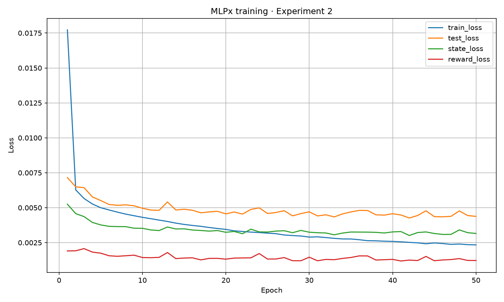
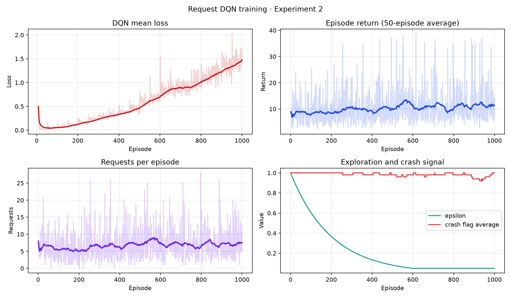

# Experiment 2: Data Scaling & Intent Previews

**Experiment 2** scaled up dataset collection by more than 3x and integrated non-mutating **intent previews** into `CustomEnv`, allowing queried neighbors to report their planned maneuvers.

- **World Model Checkpoint:** `checkpoints/experiment_2/MLPx/best.pt`
- **Request DQN Checkpoint:** `checkpoints/experiment_2/RequestDQN/best.pt`

---

## Objective & Hypothesis

Does scaling up transition data and having neighbors share their intended actions (behavior type, target lane, planned acceleration) improve world-model rollout accuracy and stabilize the request policy?

---

## Setup & Configuration

| Parameter | Setting | Description |
| :--- | :--- | :--- |
| **Dataset Size** | 80,000+ transitions | Collected across informed exploration and random no-message rollouts |
| **Intent Previews** | `preview_next_action()` | Neighbors simulate their internal controller step without advancing the environment |
| **World Model (WM2)** | 116 in / 55 out | Same architecture trained on the larger transition dataset |
| **Request DQN (DQN2)** | 1,000 episodes | Trained against frozen WM2 with communication cost = 0.05 |

---

## Training Metrics

### World Model Training Loss
The larger dataset produced lower validation loss and smoother convergence:

### Request DQN Training
Loss stabilized and mean return reached 13.82, though collision rates remained elevated:

---

## Policy Driving Video

The ego vehicle actively gathers neighbor intent previews, but continues to suffer from high-speed collisions because the planner still lacks constraints on forward acceleration:

---

## Key Findings & Lessons Learned

1. **Successful Intent Extraction:** Proved that `CustomEnv` could query a neighbor's intended acceleration and target lane without mutating the simulator state.
2. **Data Scaling Helps Loss, Not Safety:** While held-out prediction MSE improved noticeably, open-loop driving crashes did not decrease. Accurate one-step prediction was not enough to guarantee safe driving.
3. **The Need for Spatial Alignment:** The input representation still mapped messages to variable vehicle IDs rather than fixed relative spatial locations around the ego vehicle.
