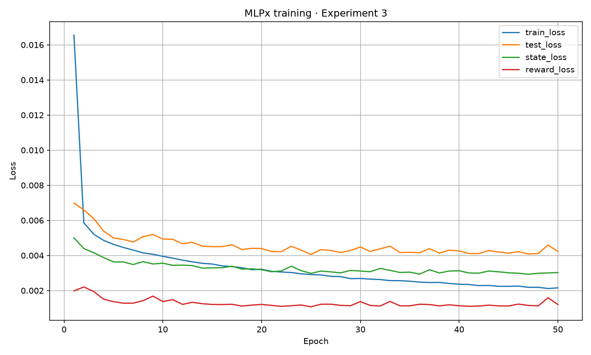
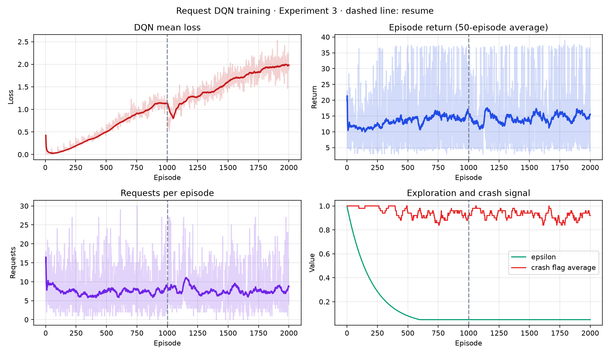

# Experiment 3: Spatial Slot Realignment & Baseline

**Experiment 3** resolved the message-alignment flaw by binding neighbor messages into **8 fixed spatial slots** around the ego car. This produced the project's stable reference baseline checkpoints (**WM3** and **DQN3**).

- **World Model Checkpoint:** `checkpoints/experiment_3/MLPx/best.pt`
- **Request DQN Checkpoint:** `checkpoints/experiment_3/RequestDQN/best.pt`

---

## Objective & Hypothesis

By organizing messages into fixed relative spatial coordinates (`left-front`, `left-beside`, etc.) and masking empty slots in the DQN action space, does the world model learn consistent spatial representations and improve decision agreement?

---

## The Spatial Slot Architecture

Messages and DQN request actions were mapped to 8 fixed spatial positions within 60 meters:

```text
       LEFT LANE              SAME LANE             RIGHT LANE
┌─────────────────────┐┌─────────────────────┐┌─────────────────────┐
│  0: Left-Front      ││  3: Same-Lane-Front ││  5: Right-Front     │
├─────────────────────┤├─────────────────────┤├─────────────────────┤
│  1: Left-Beside     ││      [ EGO CAR ]    ││  6: Right-Beside    │
├─────────────────────┤├─────────────────────┤├─────────────────────┤
│  2: Left-Rear       ││  4: Same-Lane-Rear  ││  7: Right-Rear      │
└─────────────────────┘└─────────────────────┘└─────────────────────┘
                             [ 8: Ask Nobody ]
```

---

## Setup & Configuration

| Parameter | Setting | Description |
| :--- | :--- | :--- |
| **Dataset Size** | 263,375 transitions | Corrected spatial slot representations |
| **Action Masking** | Dynamic | Empty neighbor slots are masked out so the agent only queries real vehicles |
| **World Model (WM3)** | 116 in / 55 out | 3-step action agreement reached **81.9%** |
| **Request DQN (DQN3)** | 1,000 episodes | Fixed-action spatial policy; mean return reached **15.59** |

---

## Training Metrics

### World Model Training Loss
Clean convergence on the 263k transition dataset:


### Request DQN Training
Reward and Q-loss across 1,000 episodes:


---

## Policy Driving Video

On the shared experiment-video seed **120**, the ego vehicle actively uses spatial request slots but still crashes after 6 of 40 steps without the later safety controller:


---

## Key Findings & Lessons Learned

1. **Spatial Representation Standard:** 3-step action agreement jumped to **81.9%**, confirming that relative spatial ordering is vastly superior to list-order indexing.
2. **Stable Reference Checkpoint:** Experiment 3 established the primary baseline checkpoints (`checkpoints/experiment_3/`) preserved throughout all future experiments.
3. **The Communication Value Dilemma:** Evaluated across 200 highway test seeds, DQN3 had an 88% crash rate, virtually identical to asking nobody (88.5%). On standard highway traffic, kinematics alone were sufficient to anticipate maneuvers; communication costs outweighed the small information benefit.
