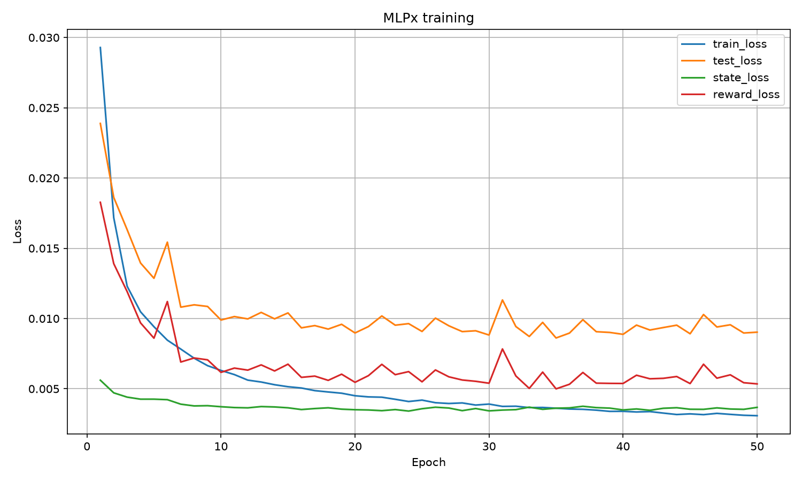
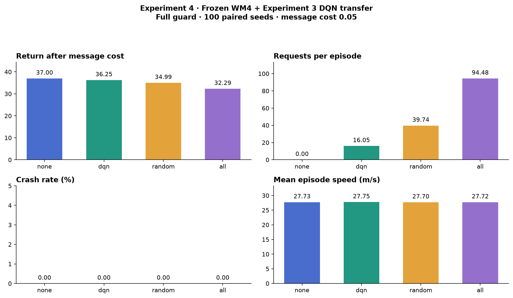

# Experiment 4: Planner Crash Forensics & Safety Guards

**Experiment 4** conducted a forensic investigation into why raw neural world-model planning crashed on test seeds despite low training loss, and introduced **executive safety guards** that completely eliminated crashes.

- **World Model Checkpoint:** `checkpoints/experiment_4/MLPx/best.pt`
- **Key Code Implementation:** `src/cooperative_driving/planner/safety.py`

---

## Objective & Hypothesis

Why does a world model with 86% action agreement crash >90% of the time in closed-loop driving, and can lightweight safety constraints guarantee collision-free navigation without slowing down cruising speed?

---

## The Three Forensic Discoveries

During 20-seed deep-dive replaying, three structural failure modes were uncovered:

1. **Runaway Target Speed:**
   Because HighwayEnv gives higher rewards for higher speeds (up to 30 m/s) and lacked an environment cap, the planner continuously issued `FASTER` commands, pushing vehicle speed above 50 m/s until braking was physically impossible.
2. **Missing Controller Memory:**
   The kinematic observation tracked vehicle speed, but omitted the ego's *target speed* and *target lane*. Without knowing whether the car was already attempting to accelerate or change lanes, the world model could not reliably predict the next step.
3. **Continuation Optimism:**
   In near-crash scenarios, the world model was overly optimistic about recovering on steps 2 and 3, repeatedly choosing `IDLE` instead of braking.

---

## The Solution: Executive Safety Guards (`safety.py`)

A four-rule filter was added to inspect planner decisions before execution:

1. **30 m/s Speed Cap (`--max-target-speed 30`):** Blocks `FASTER` if target speed is ≥ 30 m/s.
2. **Road Boundary Protection:** Blocks `LANE_LEFT` on lane 0 and `LANE_RIGHT` on lane 3.
3. **Front Braking Guard (`--safety-guard`):** Forces `SLOWER` if front clearance < 8 m or closing TTC < 3 s.
4. **Destination Clearance Guard (`--lane-change-guard`):** Blocks lane changes if the target lane lacks 8 m clearance or while a maneuver is settling.

---

## Benchmark Results Across 100 Fresh Seeds

| Controller Setup | Crashes | Finished Full Episode | Mean Speed | Settled Lane Changes |
| :--- | :---: | :---: | :---: | :---: |
| **Raw 3-Step MLPx (No Guards)** | 97 / 100 | 3% | 32.0 m/s | — |
| **MLPx + Speed Cap + Braking Guard** | 6 / 100 | 94% | 27.3 m/s | 257 commands |
| **MLPx + Full Destination Guard** | **0 / 100** | **100%** | **27.4 m/s** | **165 settled** |
| *Rule-Based Geometry Baseline* | 0 / 100 | 100% | 26.8 m/s | — |

---

## World Model Training & Policy Comparison

### World Model Training Loss (WM4)
Trained on 566k counterfactual records balanced equally across all 5 ego commands:

### Guarded Policy Comparison
Comparing DQN3, Ask Nobody, Random, and All across 100 guarded episodes:

---

## Guarded Policy Video

Driving across all 100 timesteps on the shared experiment-video seed **120** with no crash:

---

## Key Findings & Lessons Learned

1. **Crashes Reduced from 97% to 0%:** Adding executive safety guards completely eliminated collisions while preserving highway speed.
2. **Kinematics Suffice on Normal Highways:** Across 100 guarded episodes, asking nobody achieved 37.00 return with 0 crashes. DQN3 requested 16.1 times per episode but gained only +0.05 reward, losing net return due to message costs.
3. **The Next Frontier:** To demonstrate the true value of communication, we need scenarios where neighbors hide their true destination lane—leading directly to Experiment 5.
