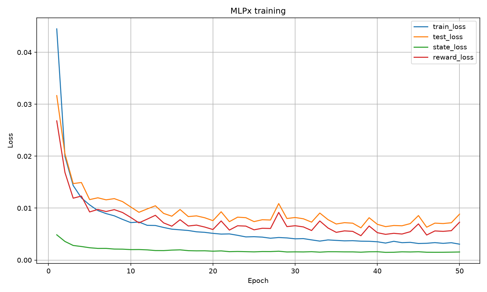
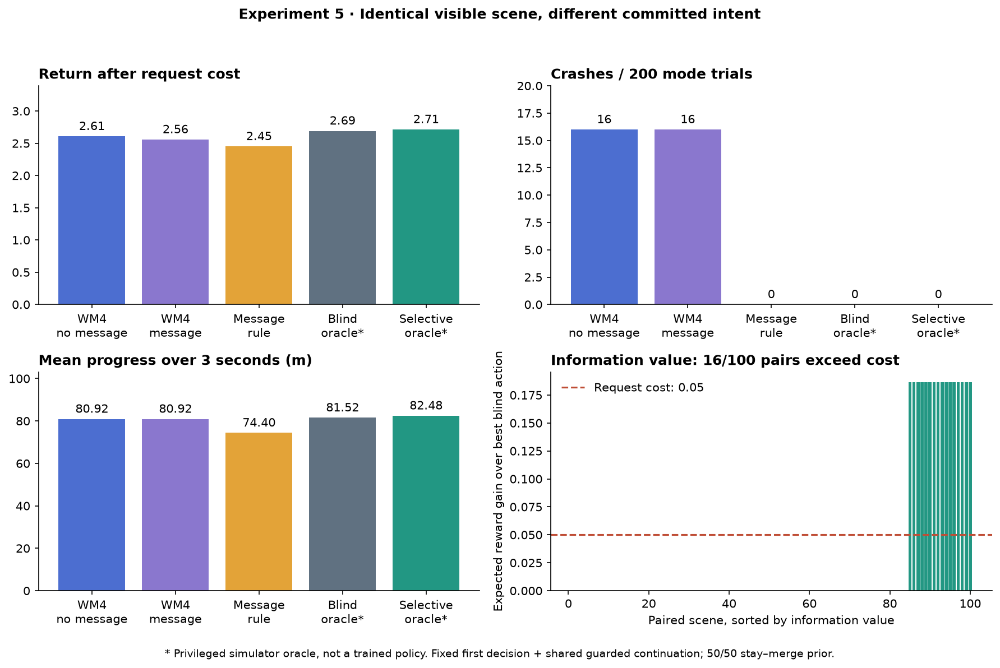
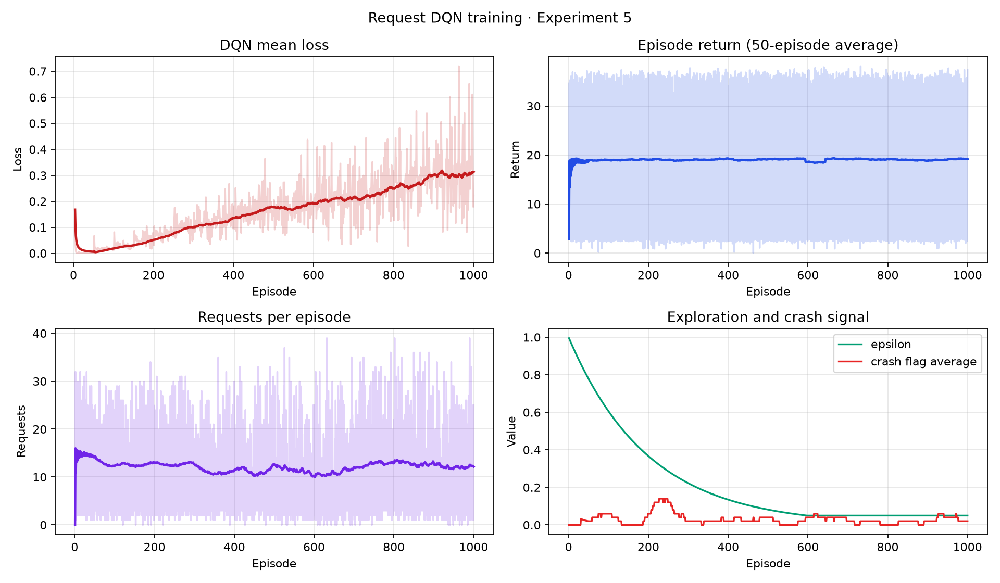
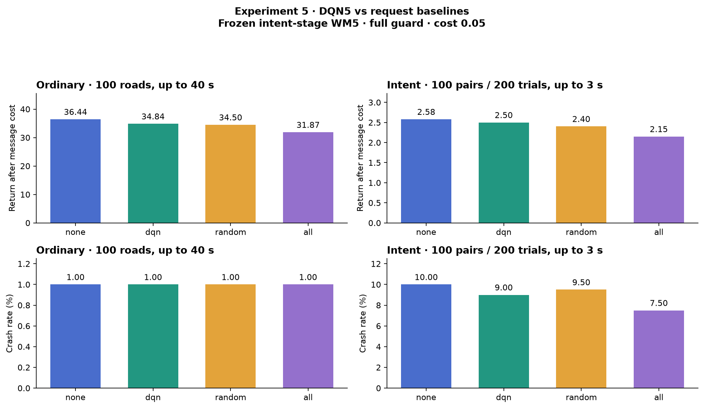

# Experiment 5: Matched-Intent Challenge Scenarios & Mixed Traffic

**Experiment 5** tests whether communication has measurable value when nearby
vehicles conceal their destination lanes. It introduces matched-intent challenge
scenes, an intent-sensitive World Model (**WM5**), and a mixed-traffic Request
policy (**DQN5**). The controlled oracle shows that selective communication can
help, while the learned DQN5 does not yet beat asking nobody after message costs.

- **World Model Checkpoints:** `checkpoints/experiment_5/MLPx/best.pt` & `intent_stage_best.pt`
- **Request DQN Checkpoint:** `checkpoints/experiment_5/RequestDQN/best.pt`
- **Challenge Environment:** `src/cooperative_driving/environments/intent_scenarios.py`

---

## Objective & Hypothesis

When neighboring vehicles have identical external kinematics but diverging hidden intentions (staying in their lane vs. aggressively cutting in), does exchanging intent messages prevent otherwise unavoidable collisions?

---

## The Matched-Intent Benchmark

For every test seed, we generate two parallel worlds with identical kinematics at the decision point:
- **World A (Neighbor Stays):** Neighbor continues straight.
- **World B (Neighbor Cuts In):** Neighbor swerves directly into the ego lane.

Only when queried does the neighbor reveal its true intended `target_lane`.

---

## Breakthrough Model: 118-Input MLPx (WM5)

To eliminate the "missing controller memory" discovered in Experiment 4, WM5 expanded the state vector to **118 inputs / 57 outputs** by adding the ego's internal target speed and target lane.

We trained two 50-epoch models on 144,945 transitions:
1. **Initial WM5 (`best.pt`):** Lowest aggregate validation loss (0.0056 MSE).
2. **Stage-Balanced WM5 (`intent_stage_best.pt`):** Re-weighted early ambiguous decisions, actively responding to neighbor intent messages.

---

## Benchmark Results: Information Value (100 Paired Scenes / 200 Trials)

| Policy / Setup | Requests / Trial | Crashes / 200 | Net Return (After Cost) | Key Finding |
| :--- | :---: | :---: | :---: | :--- |
| **Blind Acceleration Rule** | 0.0 | 16 | 2.61 | Blind car crashes when cut-in occurs. |
| **Conservative Braking Rule** | 0.0 | **0** | 2.13 | Safe, but painfully slow. |
| **Message-Conditioned Rule** | 1.0 | **0** | 2.45 | **Eliminated all 16 crashes** using intent messages. |
| **Stage-Balanced WM5 (Uninformed)** | 0.0 | 12 | 2.62 | Baseline crashes when blind to cut-in. |
| **Stage-Balanced WM5 (Informed)** | 1.0 | **6** | 2.60 | **Crashes cut in half (12 → 6)** when given intent messages! |
| **Selective Simulator Oracle** | **0.16** | **0** | **2.71** | Highest net return by asking in only 16% of scenes. |

---

## Training Metrics & Evaluation Graphs

### Stage-Balanced World Model Loss Curves
Convergence of the 118-input model on critical early decision stages:

### Information Value Benchmark
Distribution of information value across challenge scenes:

### Request DQN Training
Reward and loss over 1,000 mixed ordinary and challenge episodes:

### Policy Comparison
Comparing DQN5 against blind, random, and all-requesting baselines:

## Learned DQN5 Evaluation

DQN5 was evaluated greedily on fresh seeds with the same frozen
`intent_stage_best.pt` world model and safety guard used during training.

| Traffic set | Policy | Adjusted return | Requests | Crashes |
| :--- | :--- | ---: | ---: | ---: |
| 100 ordinary episodes | Ask nobody | **36.441** | 0.00 / episode | 1 / 100 |
| 100 ordinary episodes | DQN5 | 34.840 | 33.26 / episode | 1 / 100 |
| 200 intent trials | Ask nobody | **2.580** | 0.00 / trial | 20 / 200 |
| 200 intent trials | DQN5 | 2.500 | 1.73 / trial | **18 / 200** |

DQN5 avoided two crashes in the intent trials and beat random and all-request
policies on adjusted return. However, it queried too frequently: communication
costs outweighed the small safety gain, so asking nobody remained the stronger
cost-adjusted policy in both traffic sets. This is a closed-loop learned-policy
test and should not be confused with the simulator-oracle benchmark above.

---

## Policy Driving Video

The trained Request DQN completes all 40 steps on the shared experiment-video seed **120**, with live intent previews and executive safety guards active:

---

## Key Findings & Conclusions

1. **Messages can cut crashes in controlled tests:** Supplying genuine intent to
   the stage-balanced world model reduced crashes from 12 to 6 in its one-shot
   benchmark.
2. **The oracle target is selective:** In 16% of the controlled scenes, intent
   changed the simulator oracle's action enough to justify the request cost.
3. **DQN5 has not reached that target:** It made a modest safety improvement in
   closed-loop intent trials, but requested too often and lost adjusted return.
   The next improvement should focus on request selectivity, not merely longer
   training.
