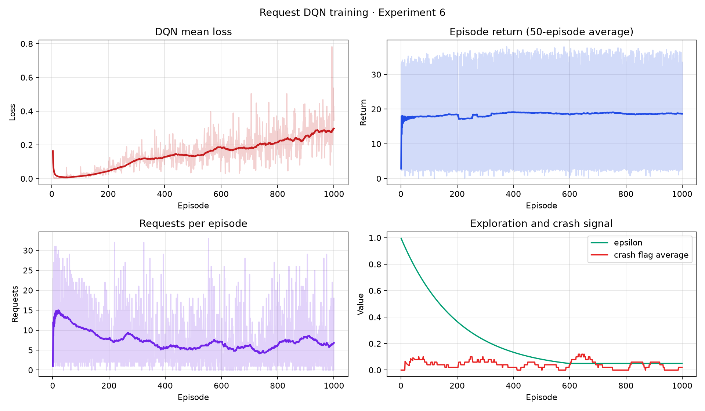
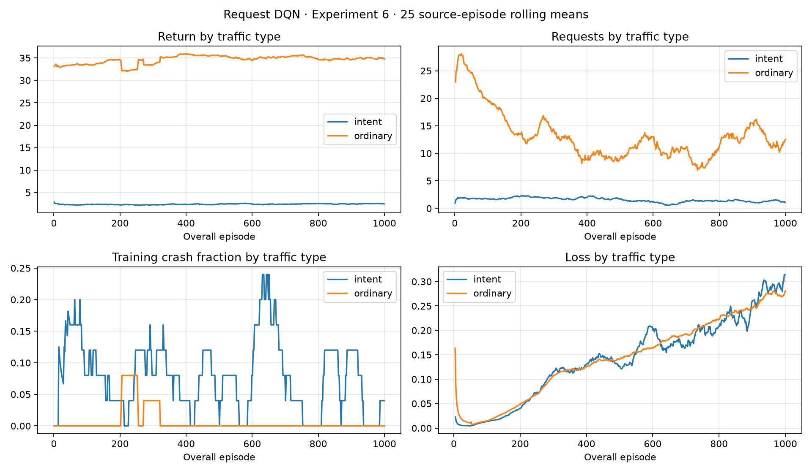
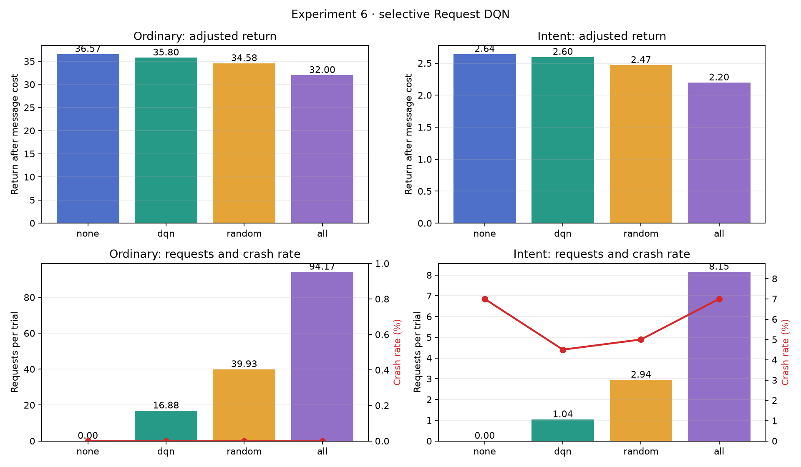

# Experiment 6: Selective Request Learning

Experiment 6 asks a narrower question: can DQN5's excessive communication be
reduced without losing the safety benefit of intent messages?

**Current status:** DQN6 with `--comfort-ttc 6` is the best learned and
safety-oriented complete policy so far. Asking nobody remains the best
communication-cost-adjusted baseline.

## Setup

- Reuse the frozen Experiment 5 stage-balanced world model.
- Train a new Request DQN for 1,000 episodes: 500 ordinary roads and 500 short
  paired-intent episodes.
- Preserve the fixed eight spatial request slots, public 45-value DQN state,
  three-step planner, and full safety guard.
- Store the new policy separately under Experiment 6.

## Configuration

| Item | Value |
| :--- | :--- |
| Frozen world model | `checkpoints/experiment_5/MLPx/intent_stage_best.pt` |
| DQN episodes | 1,000 |
| Communication cost | 0.05 per request |
| Redundant-request penalty | 0.10 |
| Replay | Equal ordinary/intent sampling |
| Planner horizon | 3 |
| Training seeds | Ordinary 1000000+, intent 1100000+ |
| Evaluation seeds | Ordinary 1200000+, intent 1300000+ |

The new teacher signal compares the planner's action with the selected message
against its action with no message. If the response changes nothing, that
request receives an additional 0.10 training penalty. This comparison is used
only to shape the training reward; the deployed DQN cannot see private intent.

## Commands

```bash
.venv/bin/python -m scripts.training.train_request_dqn \
  --experiment 6 --episodes 1000 --seed 0 \
  --mlpx-checkpoint checkpoints/experiment_5/MLPx/intent_stage_best.pt \
  --scenario-mix mixed --ordinary-seed 1000000 --challenge-seed 1100000 \
  --request-state-encoding ego_control_v1 \
  --communication-cost 0.05 --redundant-request-penalty 0.10 \
  --safety-guard --max-target-speed 30 --lane-change-guard --batched-planner
```

The ordinary and paired-intent evaluations use the same guard flags and explicit
Experiment 5 world-model checkpoint. Their complete commands and settings are
stored in the evaluation summaries listed under Artifacts.

## Results

| Traffic set | Policy | Adjusted return | Driving reward | Requests | Crashes |
| :--- | :--- | ---: | ---: | ---: | ---: |
| 100 ordinary episodes | Ask nobody | **36.566** | 36.566 | 0.00 / episode | 0 / 100 |
| 100 ordinary episodes | DQN6 | 35.801 | **36.645** | 16.88 / episode | 0 / 100 |
| 200 intent trials | Ask nobody | **2.643** | 2.643 | 0.00 / trial | 14 / 200 |
| 200 intent trials | DQN6 | 2.597 | **2.649** | 1.04 / trial | **9 / 200** |

On the exact same fresh seeds, DQN6 improved over DQN5:

| Traffic set | DQN5 return | DQN6 return | DQN5 requests | DQN6 requests | DQN5 crashes | DQN6 crashes |
| :--- | ---: | ---: | ---: | ---: | ---: | ---: |
| Ordinary | 34.943 | **35.801** | 33.31 | **16.88** | 0 | 0 |
| Intent | 2.563 | **2.597** | 1.88 | **1.04** | 10 / 200 | **9 / 200** |

## Graphs







## Rendering

```bash
.venv/bin/python -m scripts.evaluation.render_request_dqn \
  --experiment 6 --episodes 1 --seed 120 --duration 100 --delay 0.15 \
  --safety-guard --max-target-speed 30 --lane-change-guard --comfort-ttc 6
```

The renderer automatically loads DQN6 and its stored Experiment 5 world-model
path. The overlay identifies requested vehicles, displays their exact replies,
and reports safety-guard interventions.

### Recorded DQN6 rollout


This recording uses the shared experiment-video seed **120** and the smooth
controller configuration. It completes all 100 steps without a crash, earns
90.661 driving reward, and sends 52 requests.

### Smooth controller follow-up

The optional `--comfort-ttc 6` controller reacts before emergency braking,
uses a safe lane only when it offers at least equal forward clearance, waits
five decisions before another lane command, and blocks acceleration for three
decisions after braking.

| 100 ordinary roads | Original guard | Smooth controller |
| :--- | ---: | ---: |
| Adjusted return | **35.801** | 35.748 |
| Driving reward | **36.645** | 36.407 |
| Mean speed | **27.527 m/s** | 27.401 m/s |
| Completed lane changes | 171 | **240** |
| Requests | 16.88 | **13.17** |
| Crashes | **0** | **0** |

The smooth controller increased completed lane changes by 40% while changing
adjusted return by only -0.053. On the same 200 intent trials it preserved the
4.5% crash rate (9/200), 1.04 requests per trial, and nearly identical return
(2.594 versus 2.597).

## Evaluation

- On ordinary roads, DQN6 and asking nobody both completed all 100 episodes
  without crashing. DQN6's messages cost 0.765 adjusted return on average;
  the paired bootstrap 95% interval for DQN6 minus none is [-0.916, -0.606].
- In paired-intent trials, DQN6 avoided five crashes that occurred under the
  no-request policy and introduced none. Its adjusted-return difference was
  -0.046, with a scene-clustered 95% interval of [-0.078, -0.012].
- DQN6 beat random and all-request baselines on adjusted return in both traffic
  sets.
- Against DQN5 on identical seeds, DQN6 approximately halved communication,
  improved adjusted return in both traffic sets, and avoided one additional
  intent crash.
- The teacher improved request selectivity and safety, but did not make
  communication cost-effective relative to asking nobody.

### Final interpretation

Use **DQN6 + the smooth controller** for rendering, safety-oriented evaluation,
and future development. Use **ask nobody** as the reward baseline that every
future communication policy must beat after message costs.

## Artifacts

- Checkpoint: `checkpoints/experiment_6/RequestDQN/best.pt`
- Resumable state: `checkpoints/experiment_6/RequestDQN/latest.pt`
- Training run: `results/experiment_6/RequestDQN/experiments/20261120_150538_request_dqn/`
- Ordinary evaluation: `results/experiment_6/evaluation/selective_ordinary/`
- Intent evaluation: `results/experiment_6/evaluation/selective_intent/`
- Same-seed DQN5 ordinary comparison: `results/experiment_6/evaluation/dqn5_same_seed_ordinary/`
- Same-seed DQN5 intent comparison: `results/experiment_6/evaluation/dqn5_same_seed_intent/`
- Smooth-controller ordinary evaluation: `results/experiment_6/evaluation/controller_v3_ordinary/`
- Smooth-controller intent evaluation: `results/experiment_6/evaluation/controller_v3_intent/`

## Notes

The increasing TD loss means the final checkpoint should not be described as
fully converged. More episodes alone are unlikely to solve the remaining gap.
The next useful experiment is a stronger teacher or validation-selected penalty
sweep that suppresses ordinary-road requests while retaining the five avoided
intent crashes.
