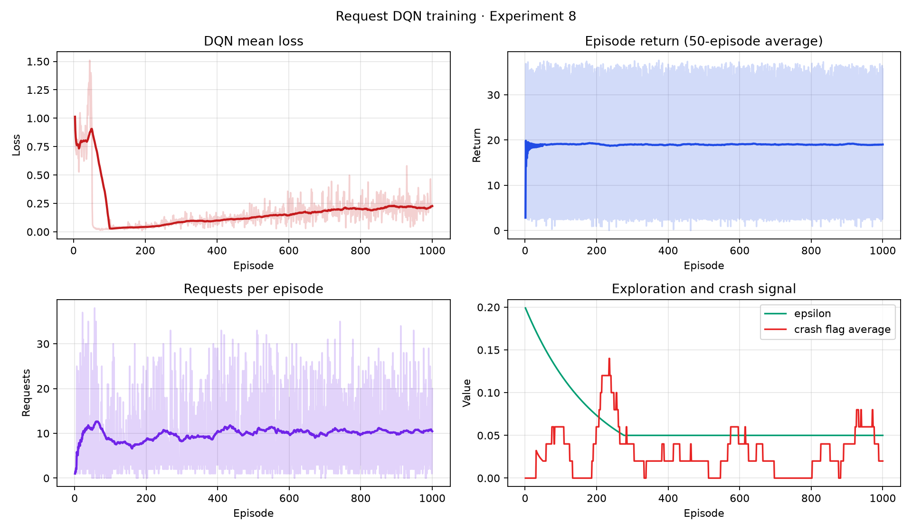
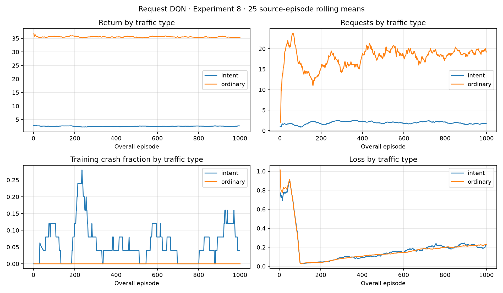

# Experiment 8: Double-DQN Fine-Tuning

*Experiment 8*

## Goal

Experiment 8 is a standalone feasibility run of a **Double DQN request policy**. It checks that the new TD target trains cleanly and produces a usable policy. Cross-experiment comparison is intentionally deferred.

## Setup

| Component | Configuration |
| :--- | :--- |
| Policy class | `RequestDDQN` in `policies/request_ddqn.py` |
| Request-policy initialization | Experiment 7 behavior-cloned checkpoint |
| World model | Frozen Experiment 5 intent-stage MLPx |
| TD target | Double DQN |
| Training episodes | 1,000 mixed ordinary and paired-intent episodes |
| Request action space | Ask nobody or one visible spatial slot |
| Planning horizon | 3 steps |
| Exploration | Epsilon starts at `0.20` and decays to `0.05` |
| Target-network update | Every 50 episodes |
| Communication cost | `0.05` per request |
| Driving controls | Safety guard, lane-change guard, 30 m/s speed cap, 6 s comfort TTC |

Double DQN separates the two jobs in the bootstrap target: the online network chooses the best valid next request, while the target network evaluates that request. Empty spatial slots remain masked.

## Training Results

| Training window | Mean return | Mean TD loss | Mean requests | Crash rate | Mean steps |
| :--- | ---: | ---: | ---: | ---: | ---: |
| First 100 episodes | 19.094 | 0.4643 | 9.82 | 4.0% | 21.45 |
| Last 100 episodes | 18.980 | 0.2223 | 10.55 | 4.0% | 21.46 |

The run remained stable across 1,000 episodes. The average TD loss in the final 100 episodes was lower than in the first 100, while return and crash rate stayed steady. The saved `best.pt` artifact is the completed 1,000-episode policy; it was not selected through a separate validation sweep.





## Standalone Evaluation

Only the Experiment 8 DQN policy was evaluated. No baseline policies were included.

| Evaluation scene | Trials | Mean return | Driving reward | Requests | Crash rate | Mean speed | Lane changes |
| :--- | ---: | ---: | ---: | ---: | ---: | ---: | ---: |
| Paired intent | 400 | 2.558 | 2.644 | 1.72 | 4.25% | 26.80 m/s | 147 |
| Ordinary highway | 100 | 35.346 | 36.309 | 19.26 | 0.00% | 27.43 m/s | 281 |

The policy completed the full ordinary-road horizon in every evaluation episode. In the short paired-intent benchmark, 17 of 400 trials ended in a collision.

## Controlled Experiments 6–8 Comparison

Experiments 6, 7, and 8 were run on identical seeds with the same frozen Experiment 5 MLPx, 3-step planner, communication cost, and safety settings.

| Scenario | Policy | Mean return | Driving reward | Requests | Crash rate |
| :--- | :--- | ---: | ---: | ---: | ---: |
| Paired intent, 400 trials | Experiment 6 DQN | 2.582 | 2.632 | 1.02 | 6.00% (24) |
| Paired intent, 400 trials | **Experiment 7 oracle-taught DQN** | **2.635** | **2.673** | **0.75** | **4.00% (16)** |
| Paired intent, 400 trials | Experiment 8 DDQN | 2.558 | 2.644 | 1.72 | 4.25% (17) |
| Ordinary highway, 100 episodes | Experiment 6 DQN | 35.540 | 36.259 | 14.38 | 0.00% |
| Ordinary highway, 100 episodes | **Experiment 7 oracle-taught DQN** | **35.941** | 36.208 | **5.35** | **0.00%** |
| Ordinary highway, 100 episodes | Experiment 8 DDQN | 35.346 | **36.309** | 19.26 | **0.00%** |

Experiment 7 is the strongest overall policy in this controlled test. It combines the lowest paired-intent crash rate with the fewest requests and highest cost-adjusted return in both scenarios. Experiment 8 reduced Experiment 6's intent collisions from 24 to 17, but it requested substantially more messages. Its Double-DQN fine-tuning therefore improved safety over Experiment 6 without improving on the Experiment 7 policy from which it was initialized.

## Commands

Training:

```bash
.venv/bin/python -m scripts.training.train_request_dqn \
  --experiment 8 \
  --episodes 1000 \
  --seed 0 \
  --td-target double-dqn \
  --init-checkpoint checkpoints/experiment_7/best.pt \
  --initial-epsilon 0.20 \
  --mlpx-checkpoint checkpoints/experiment_5/MLPx/intent_stage_best.pt \
  --scenario-mix mixed \
  --request-state-encoding ego_control_v1 \
  --safety-guard \
  --lane-change-guard \
  --max-target-speed 30 \
  --comfort-ttc 6 \
  --batched-planner \
  --save-every 50
```

Standalone paired-intent evaluation:

```bash
.venv/bin/python -m scripts.evaluation.evaluate_request_dqn \
  --experiment 8 \
  --episodes 200 \
  --seed 1700000 \
  --scenario paired-intent \
  --policies dqn \
  --planning-horizon 3 \
  --safety-guard \
  --lane-change-guard \
  --max-target-speed 30 \
  --comfort-ttc 6 \
  --batched-planner
```

## Policy Video

The `RequestDDQN` policy completes all 100 ordinary-road steps on the shared experiment-video seed **120**. It earns 90.836 driving reward, sends 82 requests, and does not crash.


Recording command:

```bash
.venv/bin/python -m scripts.evaluation.render_request_dqn \
  --experiment 8 \
  --episodes 1 \
  --seed 120 \
  --duration 100 \
  --planning-horizon 3 \
  --safety-guard \
  --lane-change-guard \
  --max-target-speed 30 \
  --comfort-ttc 6 \
  --batched-planner \
  --video docs/images/dqn_experiment_8_policy.mp4
```

## Artifacts

- Policy checkpoint: `checkpoints/experiment_8/RequestDQN/best.pt`
- Training log: `results/experiment_8/RequestDQN/experiments/20261125_121241_request_dqn/request_dqn_training.csv`
- Paired-intent metrics: `results/experiment_8/evaluation/paired_intent/request_dqn_summary.json`
- Ordinary-road metrics: `results/experiment_8/evaluation/ordinary/request_dqn_summary.json`
- Controlled Experiments 6–8 comparison: `results/experiment_8/evaluation/exp6_7_8_comparison/` and `results/experiment_8/evaluation/exp6_comparison/`
