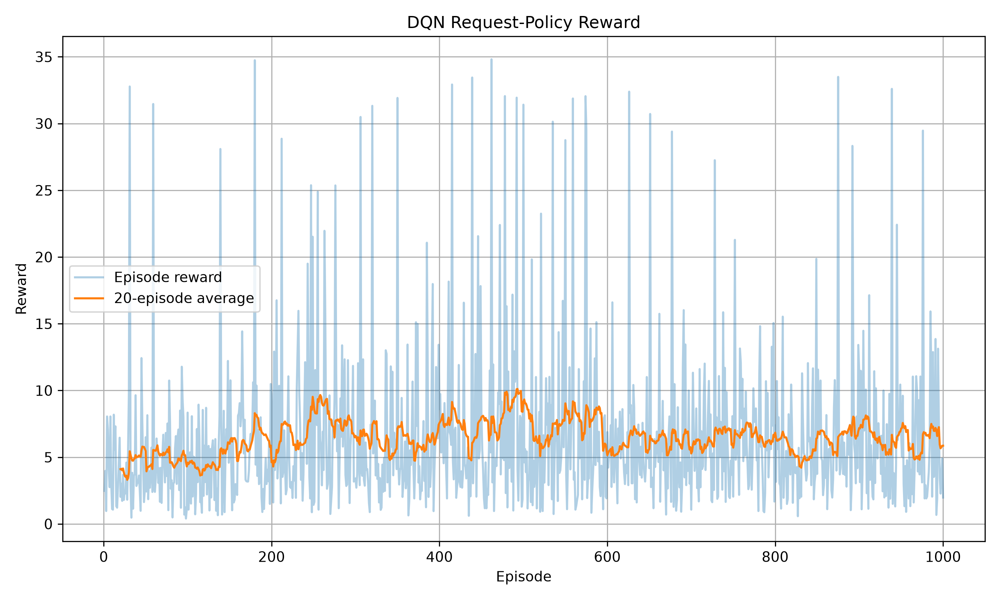
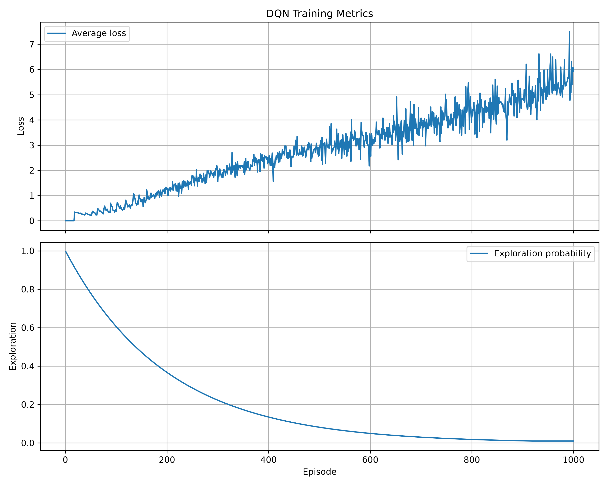
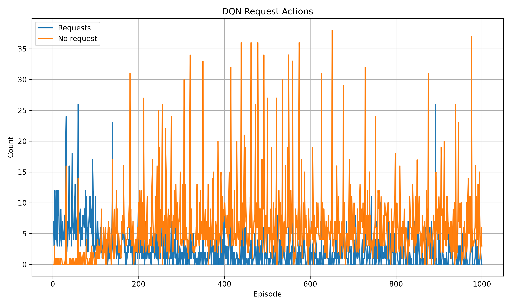
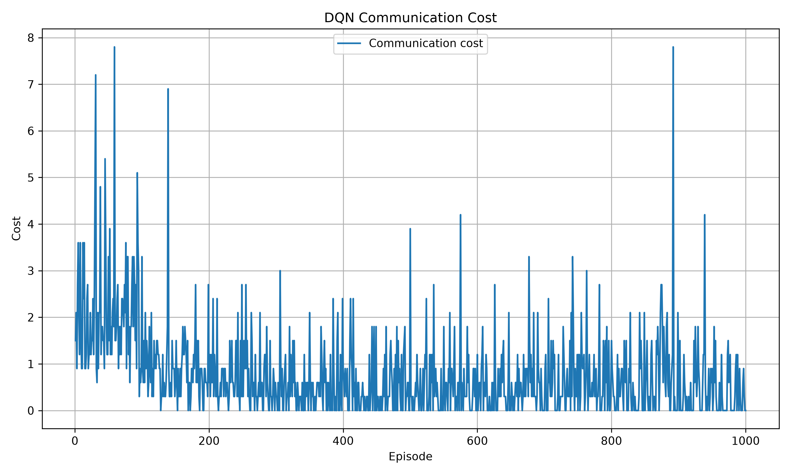
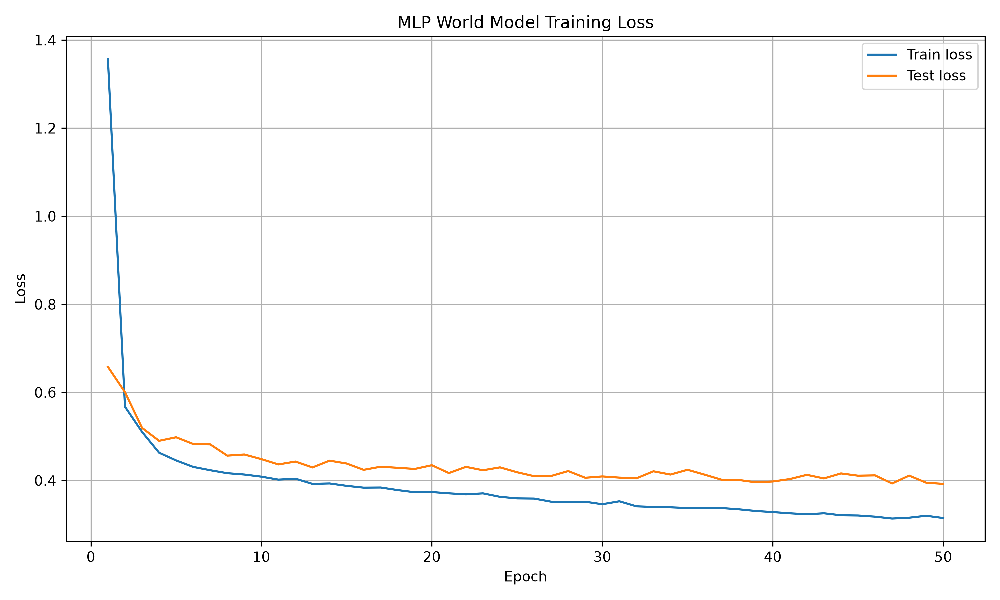
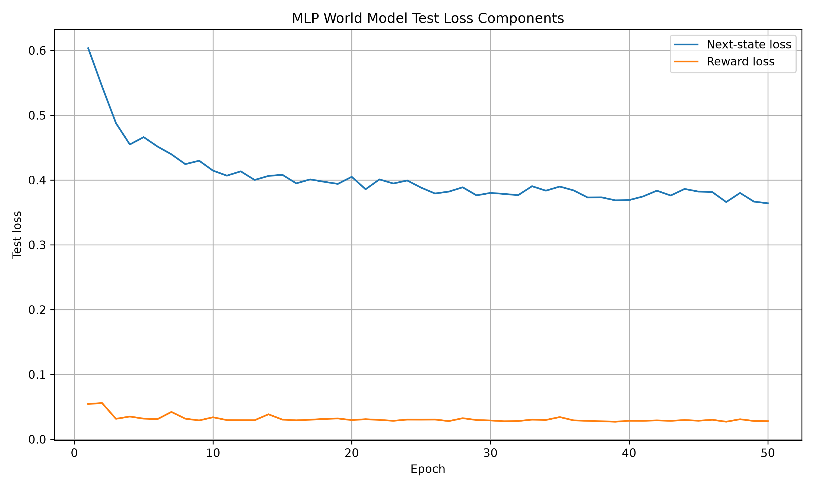

# Experiment 1 — Original DQN Request Policy

## Objective

Train a DQN to request information from one visible neighboring vehicle or
choose no request.

## Setup

- 1,000 DQN training episodes
- Five-step MCP planning
- Original MLP world model
- Visible-neighbor request masking
- Communication cost: `0.3` per request
- MLP checkpoint: `checkpoints/MLP/best.pt`

## Supporting MLP result

The 50-epoch MLP run reached a final test loss of approximately `0.3922`:

| Test state loss | Test reward loss | Test loss |
| ---: | ---: | ---: |
| 0.3642 | 0.0280 | 0.3922 |

## Artifacts

- DQN metrics: `archive/legacy_single_request/results/DQN/dqn_training.csv`
- MLP metrics: `archive/legacy_single_request/results/MLP/mlp_training.csv`
- DQN notes: `archive/legacy_single_request/results/DQN/experiments/legacy_dqn_run_001/notes.md`
- MLP notes: `archive/legacy_single_request/results/MLP/experiments/legacy_mlp_run_001/notes.md`

## Main observation

The experiment established the original single-request pipeline and provided
the baseline for resumed DQN training.

## Training graphs

<table>
  <tr>
    <td></td>
    <td></td>
  </tr>
  <tr>
    <td></td>
    <td></td>
  </tr>
  <tr>
    <td></td>
    <td></td>
  </tr>
</table>
