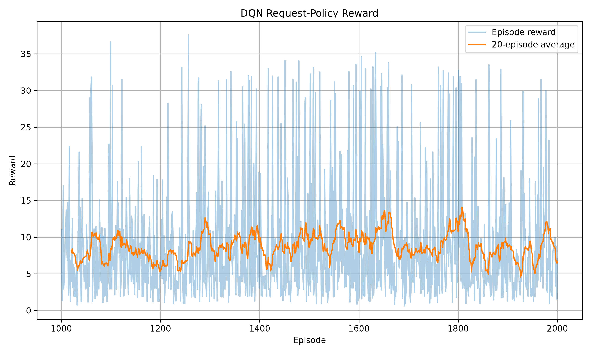
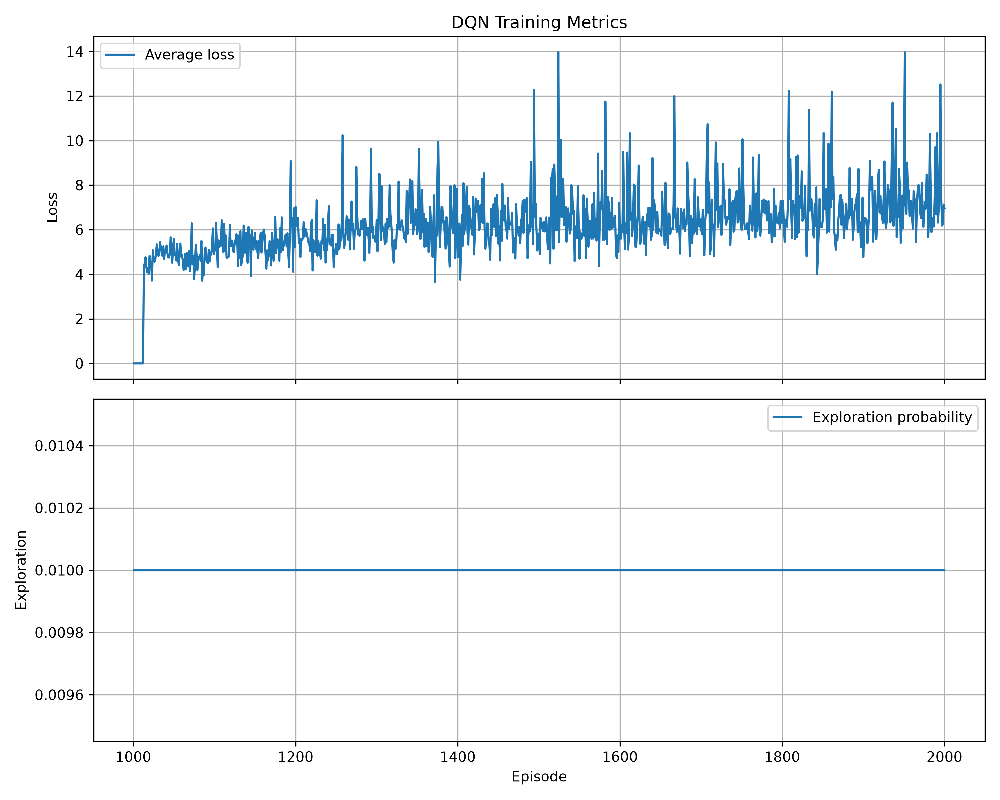
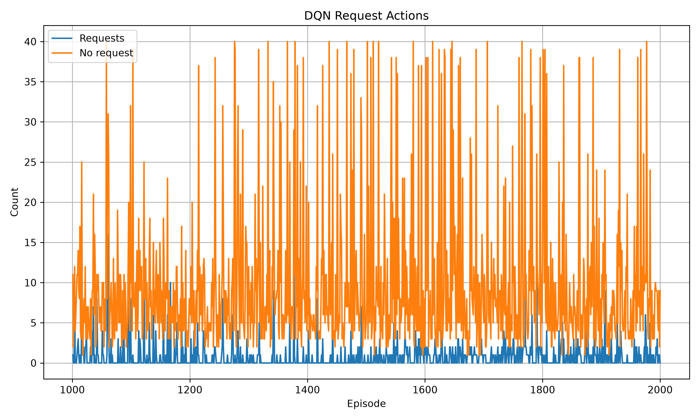
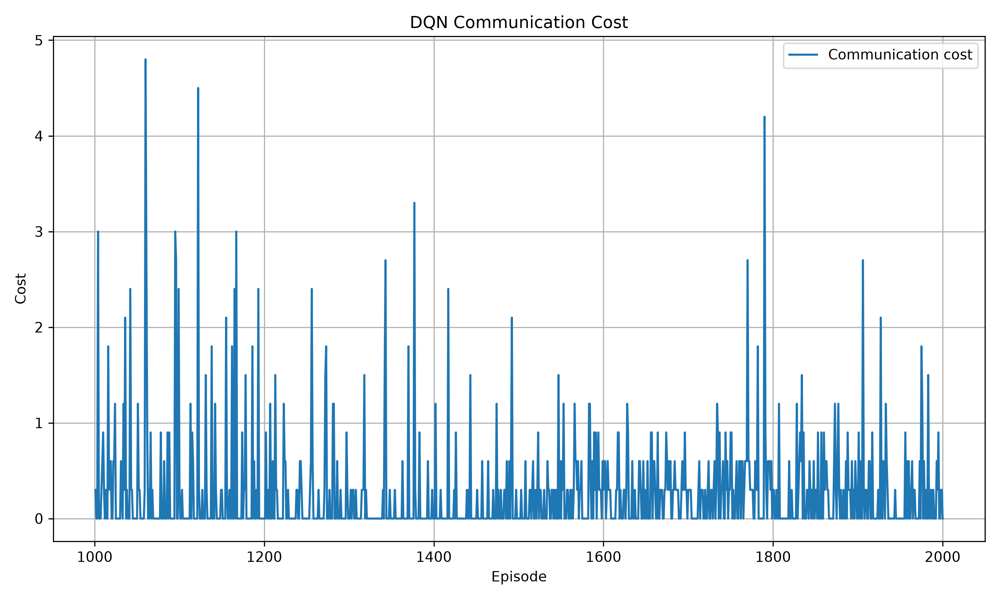
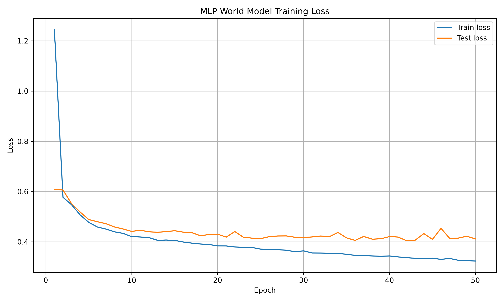
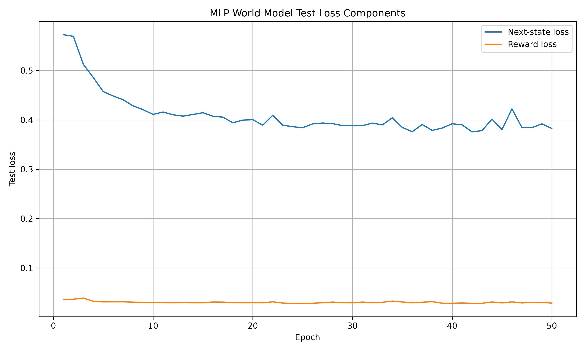

# Experiment 2 — Resumed DQN Training

## Objective

Continue the original DQN request-policy experiment from 1,000 to 2,000 total
episodes.

## Setup

- Resumed DQN training from the previous checkpoint
- Five-step MCP planning
- Visible-neighbor request masking
- Communication cost: `0.3` per request

## Results

- Average reward during resumed training: `8.67`
- Previous 1,000-episode average reward: `6.42`
- Average episode length: `10.73` steps
- Requests reduced from approximately `1.5` to `0.8` per episode
- Communication cost reduced from approximately `0.45` to `0.24` per episode
- DQN loss increased from approximately `1.76` to `7.63`

## Supporting MLP result

The second 50-epoch MLP run reached a best test loss of approximately `0.4044`
at epoch `42`. Its final test loss was `0.4117`.

| Final test state loss | Final test reward loss | Final test loss |
| ---: | ---: | ---: |
| 0.3827 | 0.0290 | 0.4117 |

## Main observation

Reward and communication efficiency improved, but increasing DQN loss showed
that the request policy was not fully stable. Evaluation against a no-request
baseline was identified as necessary.

## Training graphs

<table>
  <tr>
    <td></td>
    <td></td>
  </tr>
  <tr>
    <td></td>
    <td></td>
  </tr>
  <tr>
    <td></td>
    <td></td>
  </tr>
</table>
