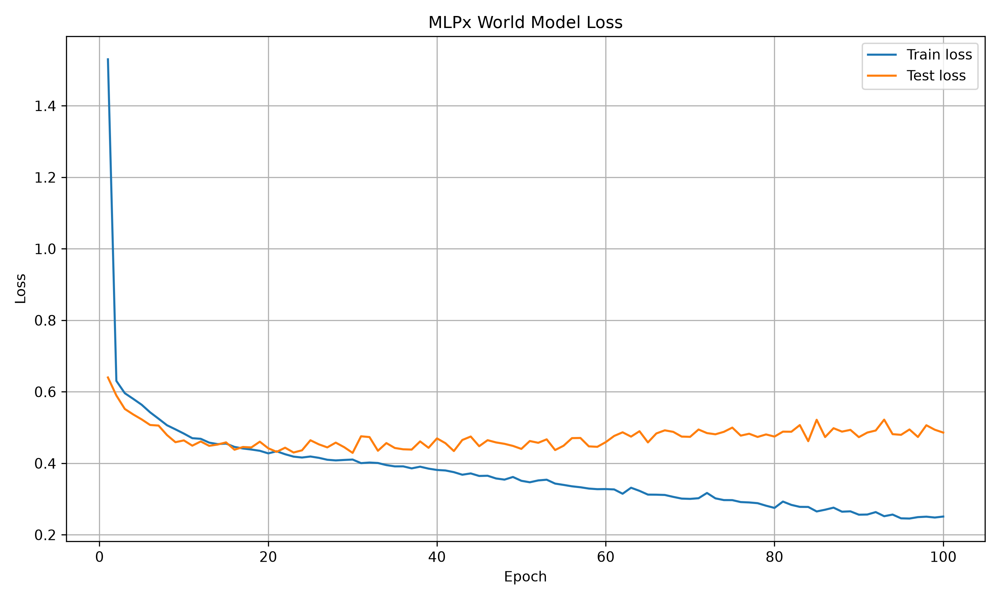
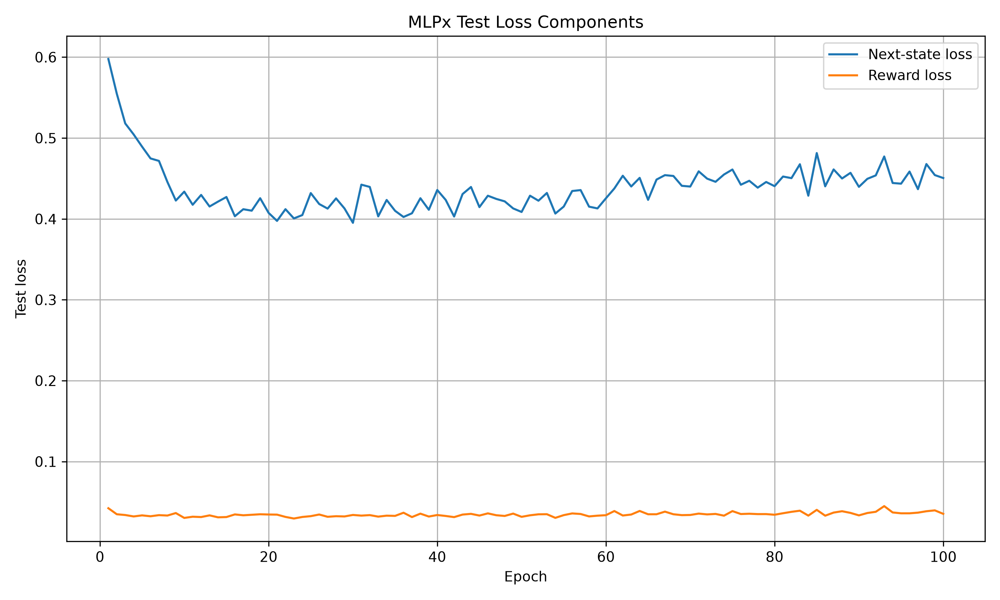
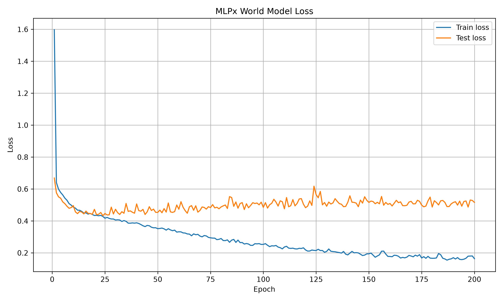
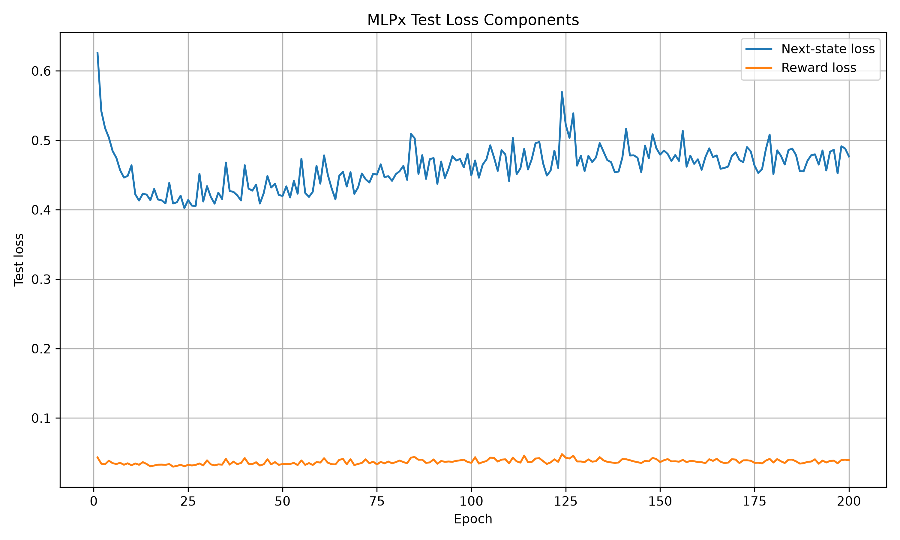
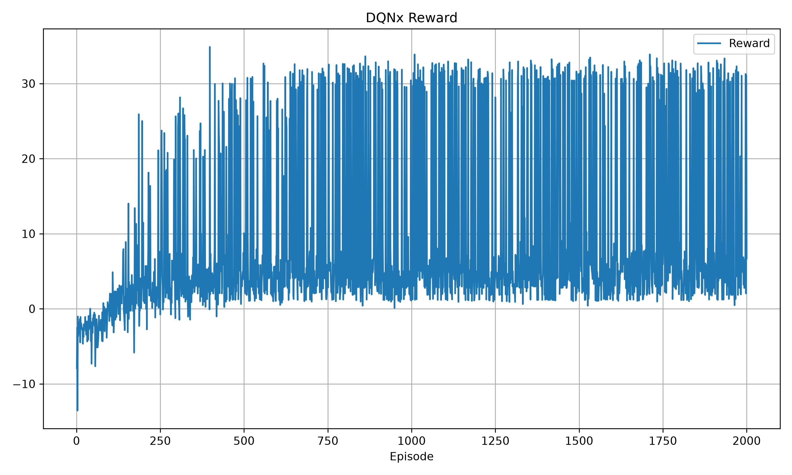
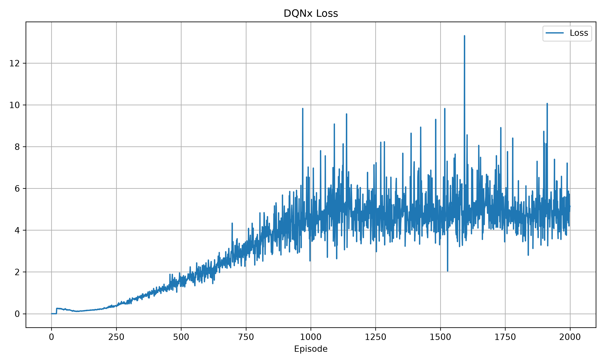
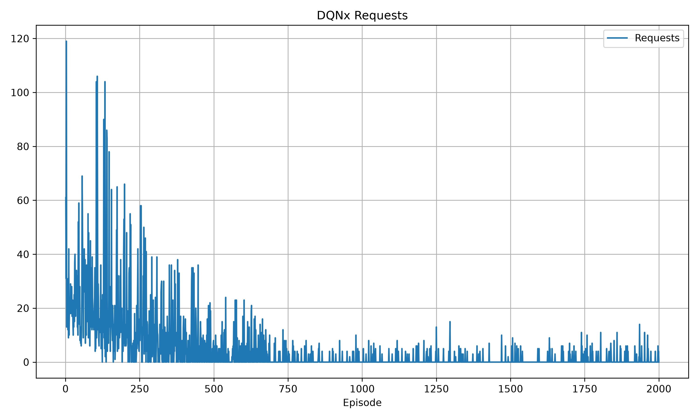

# Experiment 3 — MLPx and DQNx Multi-Request Policy

## Objective

Allow the ego vehicle to request information from multiple visible neighboring
vehicles at the same timestep.

## Pipeline

```text
observation
    → DQNx request mask
    → requested-car messages
    → MLPx world model
    → five-step MCP driving planner
    → real environment
```

DQNx was trained on real environment transitions. MLPx predictions were used
by MCP for driving-action selection, but imagined transitions were not placed
in the DQN replay buffer.

## Setup

- Ten request slots with dynamic visibility masking
- Five-step MCP planning
- Recorded DQNx training length: 2,000 episodes
- Recorded communication cost: `0.3` per requested vehicle
- Current implementation cost: `0.1` per requested vehicle

## MLPx results

| Run | Epochs | Best test loss | Best epoch |
| --- | ---: | ---: | ---: |
| `20261112_132150_mlpx` | 100 | 0.4292 | 30 |
| `20261112_132315_mlpx` | 200 | 0.4329 | 24 |

The second run worsened after its early best epoch, suggesting overfitting or
limited dataset diversity. The best checkpoint should be used for planning.

## DQNx results

For the final 100 episodes of the recorded run:

- mean reward: approximately `10.93`;
- mean DQNx loss: approximately `5.02`;
- mean requests: `0.82` per episode; and
- mean communication cost: approximately `0.246`.

The policy often selected no requests. This reduced communication cost, but it
also showed that requesting information was not yet producing a clear driving
benefit.

## Main observation

The experiment demonstrated the multi-request pipeline, but the message
content largely overlapped with the ego observation. This motivated the new
TTC-based message design, which is tracked as a separate experiment.

## Training graphs

<table>
  <tr>
    <td></td>
    <td></td>
  </tr>
  <tr>
    <td></td>
    <td></td>
  </tr>
  <tr>
    <td></td>
    <td></td>
  </tr>
  <tr>
    <td></td>
    <td></td>
  </tr>
</table>
