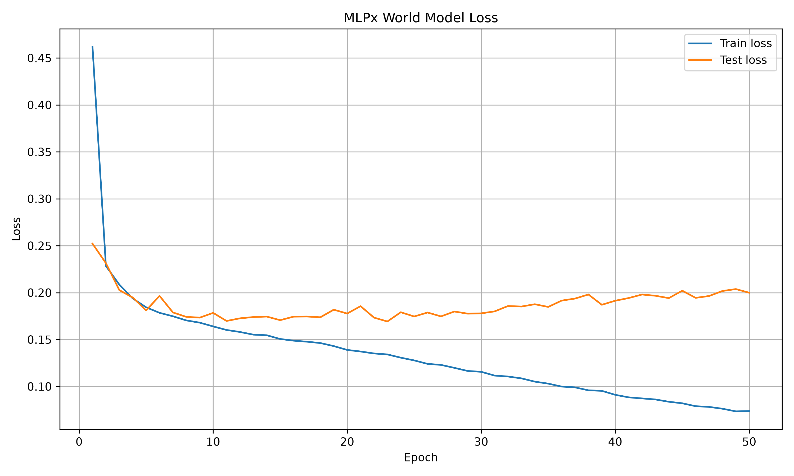
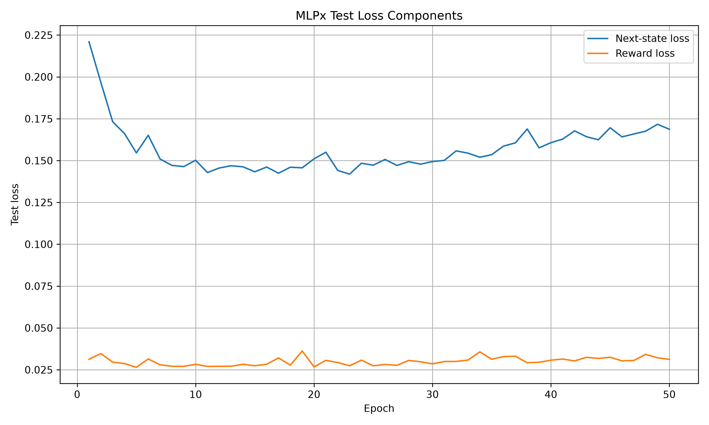
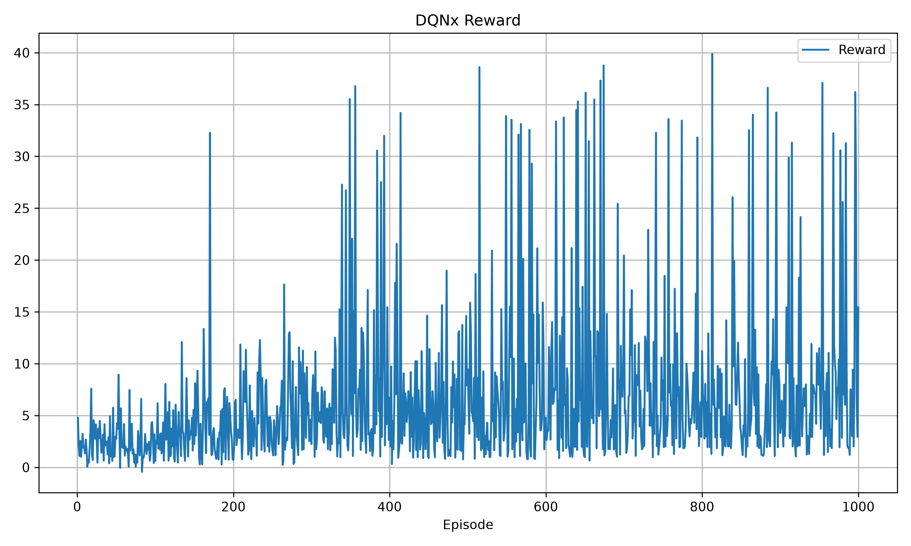
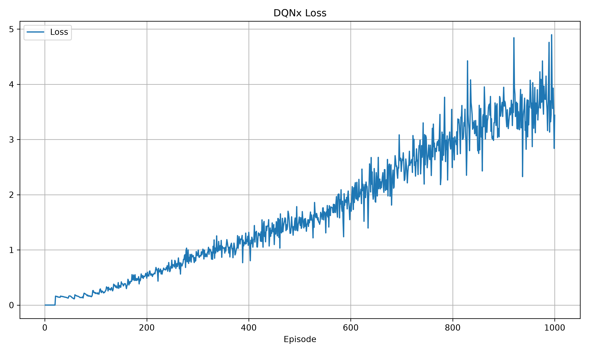
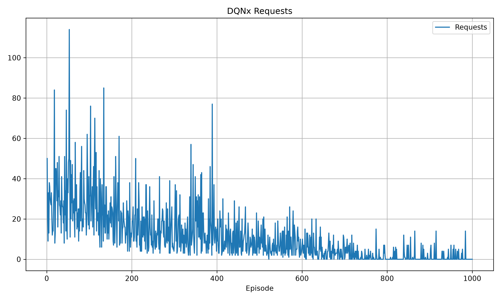

# Experiment 4 — TTC Messages with MLPx and DQNx

## Objective

Test whether DQNx can request useful information from visible vehicles when
messages contain intent and time-to-collision information that is not present
in the public kinematics observation.

## Setup

- Active dataset: `data/randomMultiRequestData_ttc.csv`
- MLPx input size: `115`
- MLPx message features: intent acceleration, intent steering, target lane,
  and time to collision
- Ten visibility-masked request slots
- Five-step MCP planner
- DQNx communication cost: `0.1` per requested vehicle
- DQNx training: `1,000` real-environment episodes

## MLPx result

The MLPx run was saved under
`results/MLPx/experiments/20261113_120917_mlpx/`.

| Metric | Result |
| --- | ---: |
| Best test loss | `0.1693` |
| Best epoch | `23` |
| Final test loss | `0.1999` |

The best MLPx checkpoint was used by the DQNx planner.

## DQNx result

The DQNx run was saved under
`results/DQNx/experiments/20261113_121105_dqnx/`.

| Evaluation policy | Driving reward | Communication cost | Total reward | Requests |
| --- | ---: | ---: | ---: | ---: |
| No requests | `5.54` | `0.00` | `5.54` | `0.00` |
| All visible cars | `4.51` | `5.04` | `-0.53` | `50.40` |
| Trained DQNx | `5.54` | `0.00` | `5.54` | `0.00` |

The comparison used the same ten fixed seeds for each policy. The trained
policy selected no requests in all ten evaluation episodes, so it matched the
no-request baseline rather than demonstrating a communication benefit.

## Interpretation

The training reward increased, but the policy learned that communication was
not worthwhile under the current model, planner, and cost. This may mean that
requested messages are not improving MLPx/MCP driving decisions enough to pay
for themselves. It may also reflect that the planner was not trained on
matched versions of the same situation with and without a request.

## Next step

Run a new experiment with communication cost `0.05`, while logging driving
reward and communication cost separately. Compare no-request, all-visible,
and trained-DQNx policies again before deciding whether to continue training.

## Training graphs

<table>
  <tr>
    <td></td>
    <td></td>
  </tr>
  <tr>
    <td></td>
    <td></td>
  </tr>
  <tr>
    <td></td>
    <td></td>
  </tr>
</table>
