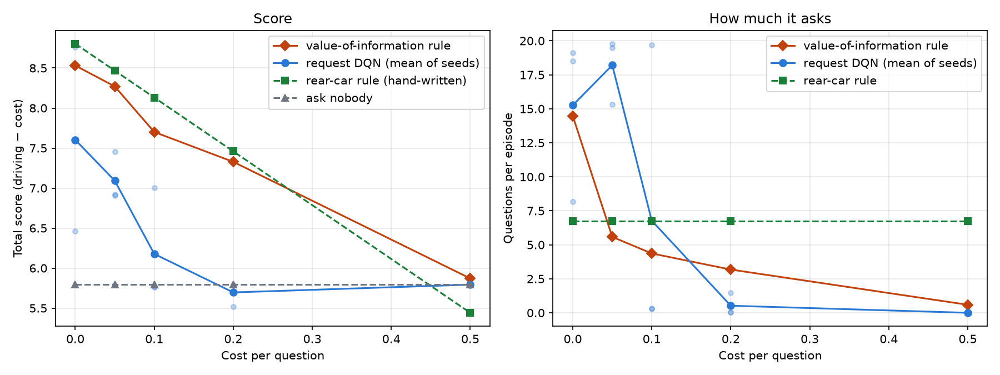

# Cooperative merge scenario

How the current experiment works, where it stands, and how it got here.
The full step-by-step record is in
[archive/merge_scenario_full_history.md](archive/merge_scenario_full_history.md).

## 1. The idea

The ego car must merge into a line of traffic. Some drivers let you in, some
don't, and **you can't tell which by watching**. Asking a car tells you, but
every question costs something. The goal: learn **when to ask, and whom**.

## 2. The scenario

`CooperativeMergeEnv` in `src/cooperative_driving/environments/customEnv.py`.

- **Road:** two lanes. The ego starts in the lower lane at 25 m/s.
- **Forced merge:** a stalled car blocks the ego's lane 250–350 m ahead, so
  the ego must move into the upper (target) lane.
- **Platoon:** the target lane has 9 cars, 25–45 m apart, at 23–26 m/s.
- **Hidden driver type** (50/50 per car, `DriverTypeIDMVehicle`):
  - *yielding*: when a car merges in front of it (within 40 m), it brakes to let it in;
  - *aggressive*: it speeds up (6 m/s²) and closes the gap. Merging in front of it usually crashes.
  - Both drive identically until someone merges, so the type can't be seen in advance.
- **Ego actions:** change left, change right, keep going, faster, slower.
  A built-in cruise control prevents silly rear-end crashes.
- **Episode:** 20 steps (1 per second).
- **Reward per step:** `0.4 × speed score + 0.6 × in target lane`; a crash gives −2 and ends the episode.

## 3. Messages

A car that is asked replies with 4 numbers (`encode_message` in
`communication/getMessage.py`):

| Value | Meaning |
| --- | --- |
| driver type | +1 yielding, −1 aggressive, 0 other |
| intent acceleration | its current acceleration [m/s²] |
| target lane | the lane it is heading for |
| time to collision | seconds until it reaches the car ahead (max 10) |

The driver type is the one that matters; it can't be learned from watching.

## 4. How we know the message matters

Three checks, in this order: is the scenario worth studying, does the
dataset contain the signal, and can the model learn it.

**Step 1: before any data, prove the message matters.**
`scripts/check_information_gap.py` uses only hand-written rules, no learning,
on 300 seeds. It answers two questions:

- *Is the driver type hidden?* A classifier guessing "yielding or
  aggressive?" from what the ego sees (position, speed, change in speed)
  scores **51.4%**, exactly chance. Before the merge, the two types look the same.
- *Does knowing it help?* Three rules drive the same roads:

  | Rule | What it does | Score | Crashes |
  | --- | --- | ---: | ---: |
  | merge now | gamble, never ask | 5.17 | 52% |
  | no info | wait for a gap that is safe against *any* driver | 4.64 | 0% |
  | ask rear | same, but when the gap is only safe for a yielding driver, ask the rear car | **7.35** | 0% |

  "no info" and "ask rear" differ only in the message, which is worth about
  **+2.7**. So the scenario is worth learning on: the information is hidden
  *and* useful.

**Step 2: collect data where the message's effect is visible.**
`scripts/collect_multi_request_data.py`, 10,000 episodes (125,792 steps):

- Every visible car is asked with **50% probability**, at random, every step.
  The same kinds of situations appear with and without each car's message,
  like a controlled experiment.
- **Merges happen at varied moments:** each episode picks a random merge step
  (0–12). Before it the ego only changes speed, then it merges, then it drives
  randomly. So the data has merges from many gaps and speeds, in front of
  both driver types.
- The driving never uses the messages; the data records what happens after
  each merge and what each car would have said.

**Step 3: check that the data has the signal.** Every lane change into the
target lane with a rear car within about 40 m, grouped by the rear car's
answer:

| Rear car's answer | Merges | Crashed within 3 steps |
| --- | ---: | ---: |
| aggressive | 2,802 | **76%** |
| not asked | 6,632 | 51% |
| yielding | 3,689 | **31%** |

The data clearly says "aggressive means danger". So when MLPx v3 ignored
messages, the problem was the model, not the data. That led to the
per-vehicle MLPx and the "crash within 3 steps" output, after which the
learned planner got +2.68 from asking the rear car (section 6). "Yielding"
is not 0% because the random driving after the merge sometimes crashes
anyway; the difference between the rows is what matters.

## 5. How the system works

```text
each step:  DQN picks whom to ask  ->  message  ->  planner imagines the future with MLPx  ->  driving action
```

**Data** (`scripts/collect_multi_request_data.py`): 10,000 episodes with
random asking and varied merges; see section 4, step 2.

**MLPx, the world model** (`models/MLPx/mlpx.py`). Input: what the ego sees,
the action, who was asked, and the messages. Output: next observation,
reward, "crash this step?" and "crash within the next 3 steps?". Each car is
encoded *together with its own message* by one shared network; the cars are
then pooled into a scene summary.

**Planner** (`planner/MCP.py`): tries every 3-step action sequence in MLPx
and picks the best first action. A step's value is
`p_crash × (−2) + (1 − p_crash) × (reward + 0.99 × best future)`.
For the first step, `p_crash` is the "crash within 3 steps" probability, which
catches a merge that only goes wrong two steps later.

**Request DQN** (`policies/DQN.py`, `scripts/train_DQN.py`): each step it
asks one visible car or nobody (11 actions). It scores every car with one
shared network, like MLPx. Reward = driving reward − 0.05 per question.
Training: 3,000 episodes, Double DQN, 3-step returns, and exploration that
mostly asks cars in the target lane. The model that is kept is the one that
scores best on 100 fixed validation roads (seeds 200,000+), checked every 250
episodes once exploration is mostly over.

**Evaluation** (`scripts/evaluate_merge_policies.py`): every request policy
drives the same 200 unseen seeds with the same planner.

## 6. Current results

The information-gap check is in section 4.

**Request policies with the learned planner** (200 unseen seeds, cost 0.05
per question; baselines in `results/merge_policies/cost0.05_dqn_v3_nstep.json`,
DQNs in `results/merge_policies/cost0.05_dqn_val_selection.json`):

| Policy | Total score | Crashes | Merged | Questions / episode | Share to rear car |
| --- | ---: | ---: | ---: | ---: | ---: |
| ask nobody | 5.79 | 18% | 78% | 0 | – |
| ask everyone | 2.03 | 0% | 97% | 152 | 13% |
| random car each step | 5.58 | 15% | 82% | 18.7 | 12% |
| rear-car rule (hand-written) | **8.47** | 0% | 97% | 6.7 | 100% |
| DQN, training seed 0 (current) | 6.92 | 1% | 94% | 15.3 | 60% |
| DQN, training seed 1 | 7.45 | 3% | 94% | 19.8 | 71% |
| DQN, training seed 2 | 6.90 | 4% | 94% | 19.5 | 28% |
| **DQN, average of 3 runs** | **7.09** | 3% | 94% | 18.2 | 53% |
| **Value-of-information rule** (no learning) | **8.27** | 4% | 92% | **5.6** | 68% |

- **The planner uses messages well:** the rear-car rule gains +2.68 over
  asking nobody, which is close to the true value (+2.7).
- **The value-of-information rule is the best learned-model policy:** it
  uses only MLPx and the planner, is within noise of the hand-written rule
  (8.27 ± 0.29 vs 8.47), and asks less (5.6 vs 6.7 questions). See below.
- **The DQN learned to ask, but poorly:** every run beats asking nobody, by
  +1.30 on average, but it asks about three times as often as needed and is
  1.2 below the value-of-information rule.
- The current DQN (`checkpoints/DQN/best.pt`) is training seed 0: it had the
  best validation score (7.98). It was not chosen by test score.

**Value-of-information rule** (`src/cooperative_driving/policies/voi.py`).
For each car in the target lane, the planner imagines both answers
("yielding" and "aggressive"; the other message values are filled with what
platoon cars almost always say). The value of asking is how much better the
ego could drive if it knew the answer than if it had to pick one move
without it. That's 0 when the same move is best either way (after the merge,
or for the front car) and positive when the answer would change the move.
The rule asks the most valuable car, if that value beats the question's
cost. It needs no training. To keep it fast, the planner got a batched
version of its value calculation (`action_values_batched`, 17× faster, same
best move in 368 of 368 test plans); the planner that drives is unchanged.

**Where the DQN asks** (`scripts/check_dqn_requests.py`, same 200 test
roads, results in `results/dqn_requests/`). A step is *decisive* when the
planner would choose a different move with the rear car's answer than
without it.

| Situation | Share of steps | Asks nobody | Asks rear car | Asks front car | Share of all questions |
| --- | ---: | ---: | ---: | ---: | ---: |
| decisive (before merge) | 21–25% | 0–6% | 36–63% | 27–51% | 21–31% |
| not decisive (before merge) | 17–20% | 0–6% | 37–62% | 18–38% | 17–24% |
| after merge | 52–59% | 0–40% | – | – | **41–59%** |

(Ranges over the three training seeds. Before the merge, the remaining
questions go to other cars.)

- **Whom:** at decisive moments it asks the rear car only 36–63% of the time.
  Most other questions go to the *front* car, the neighbour on the other side
  of the gap, whose type doesn't matter because the ego merges behind it.
- **When:** it asks just as much at non-decisive moments as at decisive ones,
  and almost never chooses "nobody" before the merge.
- **After the merge** it keeps asking: about half of all its questions are
  asked after it has already merged, when no answer can change anything.
- Likely cause: a question costs only 0.05, while one episode's score varies
  by about ±4, so the cost of a useless question is too small for the DQN to
  notice. The rear and front cars also look alike (both close, in the target
  lane), differing mainly in whether they are behind or ahead.

**Cost sweep** (`scripts/evaluate_cost_sweep.py`, 3 training seeds per cost
for the DQN, 200 test roads; `results/cost_sweep/summary.json`). The
baselines' scores at each cost are their driving reward minus cost × questions.



| Cost per question | Value-of-information rule | its questions / ep | its crashes | DQN total (mean, min–max) | DQN questions / ep | Ask nobody | Rear-car rule |
| ---: | ---: | ---: | ---: | --- | ---: | ---: | ---: |
| 0 | 8.53 | 14.5 | 5% | 7.60 (6.46–8.76) | 15.3 | 5.79 | 8.80 |
| 0.05 | 8.27 | 5.6 | 4% | 7.09 (6.90–7.45) | 18.2 | 5.79 | 8.47 |
| 0.1 | 7.70 | 4.4 | 6% | 6.18 (5.76–7.00) | 6.8 | 5.79 | 8.13 |
| 0.2 | 7.33 | 3.2 | 7% | 5.70 (5.52–5.79) | 0.5 | 5.79 | 7.46 |
| 0.5 | **5.87** | 0.6 | 14% | 5.79 (all three) | 0.0 | 5.79 | 5.44 |

(Each score has a standard error of about ±0.3.)

**The value-of-information rule does what the DQN couldn't:**

- **It asks less as questions get pricier, smoothly:** 14.5 → 5.6 → 4.4 →
  3.2 → 0.6 questions per episode. No retraining, just a different cost.
- **It beats the DQN at every cost** and asking nobody at every cost
  (barely at 0.5).
- **It asks the right car more as cost rises:** the share of its questions
  going to the rear car grows from 48% to 97%.
- **It's close to the hand-written rule** (0.13–0.43 below it up to cost 0.2,
  within about 1–1.5 standard errors) and **beats it at 0.5**, where asking
  the rear car every time no longer pays.
- **Remaining gap:** it crashes 4–7% where the hand-written rule crashes 0%,
  probably where MLPx's imagined values misjudge a merge.

**The DQN, by contrast:**

- **All or nothing.** Each DQN either asks almost every step (15–20
  questions) or never asks. At cost 0.1 one seed asks 19.7 times per
  episode and the other two 0.3 times; the mean of 6.8 hides that. It never
  learns the middle option: ask a few times, at the right moments.
- **It gives up too early.** From cost 0.2 the DQN stops asking, though the
  rear-car rule is still worth +1.67 there. Asking the rear car stays worth it
  up to a cost of about 0.45 (where the rule's line crosses "ask nobody").
- **Only at 0.5 is never asking right**, and there the DQN matches it.
- **Even free questions aren't enough:** at cost 0 the DQN reaches 7.60
  against 8.80 for the rule, so the front/rear confusion costs more than
  the question cost does.
- This matches the request check above: since the DQN can't tell decisive
  moments from the rest, its only real choices are "always ask" or "never
  ask", and which one wins depends on the cost.

## 7. History

| Step | What changed | Result | What it taught us |
| --- | --- | --- | --- |
| Information-gap check | Hand-written rules | Asking the rear car: 7.35 vs 4.64 (safe, no asking) | The information is hidden and worth asking for |
| MLPx v1 | Plain MLP, 2k episodes | Planner crashes ~50% with or without messages | Crash risk is washed out by later rewards |
| MLPx v2 | Added a crash head | Crash AUC 0.96, messages still help little | Not enough data |
| MLPx v3 | 10k episodes | Drives better, ignores messages | A flat MLP can't pair a car with its message |
| MLPx v4 | Per-vehicle encoder | Rear rule +0.66 over none | Crashes 2 steps later get blurred |
| DQN run 1 | First request DQN (on v4) | 6.27, same as asking nobody | Planner gained too little from messages |
| MLPx v5 | "Crash within 3 steps" head | Rear rule +2.68 over none | Planner now uses messages fully |
| DQN run 2 | Same DQN on v5 | Learned to never ask (5.78) | It never saw a question pay off |
| **DQN run 3** | Target-lane exploration + 3-step returns | **6.77, crashes 2%** | First DQN that learned to ask |
| DQN run 4 | Same as run 3, 6,000 episodes | 6.28, crashes 13%, 17 questions / ep | Longer training doesn't help: the score swings between 5.9 and 7.1 after exploration ends. Run 3 stays the current DQN |
| Seed check | Run 3's settings with training seeds 1 and 2; a steadier variant (learning rate 5e-5, target copy every 2,000 steps) | Seeds 0 / 1 / 2: 6.77 / 6.87 / 5.96 (mean 6.53); steadier: 6.11 | Results depend a lot on luck; all beat asking nobody (5.79) but seed 2 only barely. The steadier settings didn't help |
| **Validation selection** | Same 3 trainings; keep the model that scores best on 100 fixed validation roads instead of the training average | **6.92 / 7.45 / 6.90 (mean 7.09), crashes 1–4%** | Picking the model was a big part of the problem: same training, +0.56 on average and much less luck. Seed 0 becomes the current DQN |
| Request check | Labelled each step decisive / not / after merge, and whom the DQN asked | Rear car at only 36–63% of decisive moments; ~half of questions after the merge | It confuses the rear and front car and hasn't learned *when* to ask |
| Cost sweep | Costs 0, 0.05, 0.1, 0.2, 0.5, 3 seeds each | Asks ~15–20 times or never; stops asking from 0.2 though asking pays up to ~0.45 | All-or-nothing: it never learned to ask a few times at the right moments |
| **Value-of-information rule** | No learning: the planner imagines both answers of each target-lane car and asks only if the answer could change the move | **8.27 at cost 0.05 with 5.6 questions; beats the DQN and asking nobody at every cost** | The world model itself knows when asking is worth it. Close to the hand-written rule, and asks less as cost rises |

## 8. Where things are

| What | Where |
| --- | --- |
| Data | `data/mergeMultiRequestData.csv` |
| Current MLPx (v5) | `checkpoints/MLPx/best.pt` (run `results/MLPx/experiments/20261115_185956_mlpx/`) |
| Current DQN (validation selection, seed 0) | `checkpoints/DQN/best.pt` (run `results/DQN/experiments/20261116_214544_dqn_cost0.05/`) |
| Other seeds and variants | `checkpoints/DQN_seeds/` |
| Cost sweep models and results | `checkpoints/DQN_sweep/`, `results/cost_sweep/` |
| Older models | `checkpoints/MLPx_merge_history/`, `checkpoints/DQN_history/` |
| Evaluation results | `results/merge_policies/` |

## 9. Next steps

1. Close the value-of-information rule's crash gap (4–7% vs 0% for the
   hand-written rule): look at the roads where it crashes and check whether
   MLPx's imagined values were wrong there.
2. Use the value-of-information rule as a teacher for the DQN: train the DQN
   to copy its choices, giving a fast learned policy without the noisy
   reward problem.
3. Optional: the same idea on a 4-lane highway with normal traffic.
