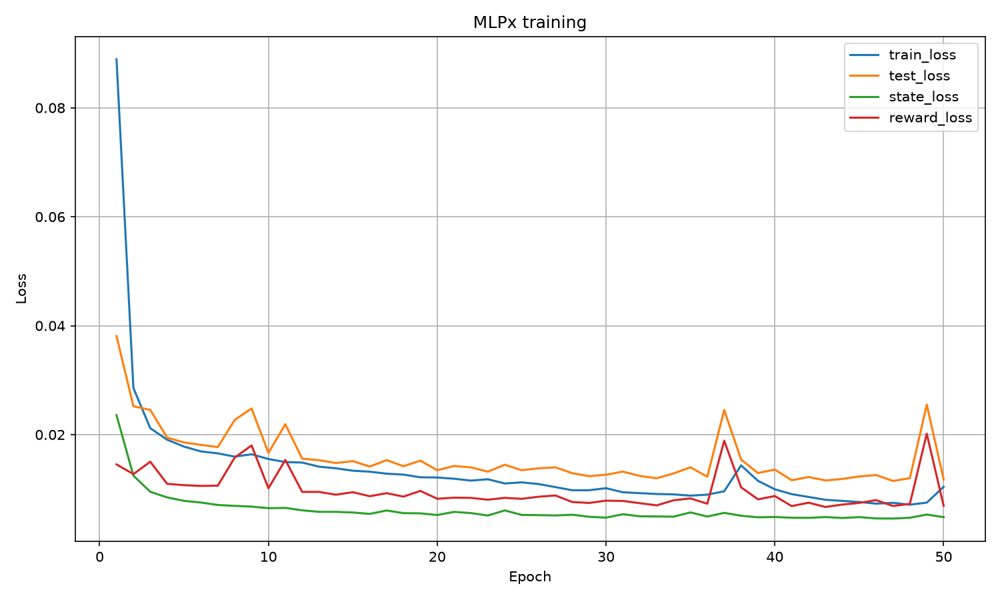
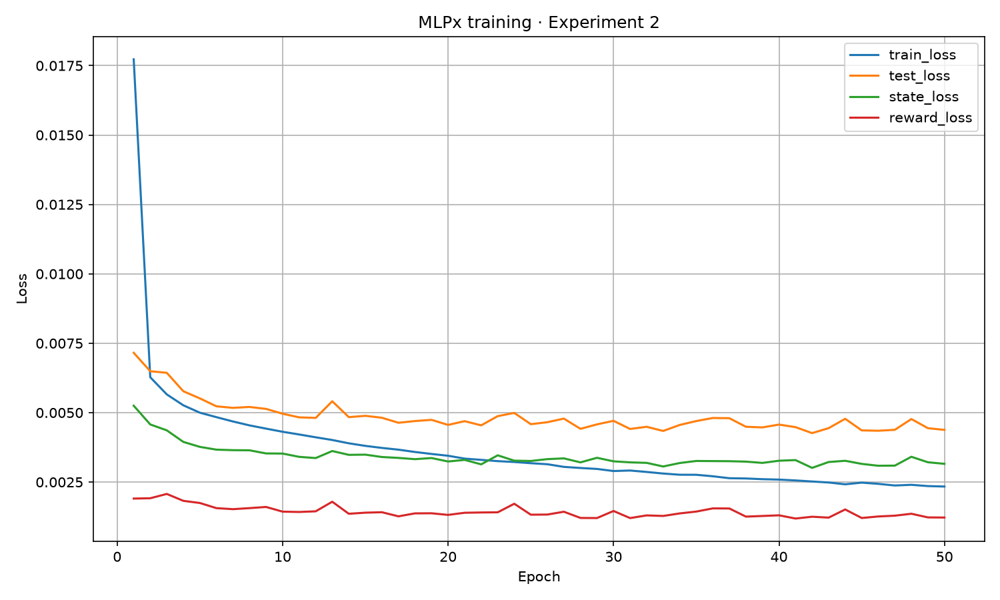
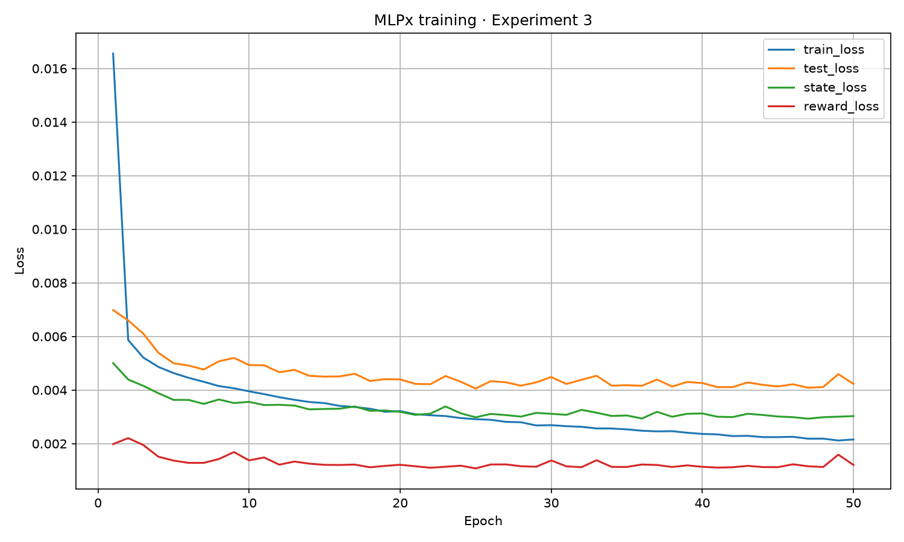

# MLPx world model

MLPx is the learned one-step world model. It predicts what happens after the ego takes an action.

## Input

The model receives 116 values:

| Input | Size | Meaning |
| --- | ---: | --- |
| Current state | 55 | 11 observation rows × 5 kinematic features |
| Ego action | 5 | One-hot action: `LANE_LEFT`, `IDLE`, `LANE_RIGHT`, `FASTER`, `SLOWER` |
| Messages | 56 | 8 spatial slots × 7 message features |

Message slots use this fixed order:

```text
left-front, left-beside, left-rear,
same-lane-front, same-lane-rear,
right-front, right-beside, right-rear
```

Each message contains presence, behavior type, target lane, target speed, acceleration, steering, and the vehicle crash flag. Unrequested or missing slots are zero-padded.

## Architecture

```text
116 inputs
  -> Linear(256) -> ReLU
  -> Linear(256) -> ReLU
  -> Linear(128) -> ReLU
  -> next-state head: 55 values
  -> reward head: 1 value
```

The model intentionally has no crash head. Crashes remain available as dataset metadata and can be analyzed separately.

## How to read the results

State MAE uses normalized observations. Reward MAE compares predicted and real
cumulative rewards. Action agreement measures whether the predicted best first
action matches the highest real return among the tested candidates.
Experiments 1 and 2 used repeated actions and excluded early-ending cases.
The corrected evaluator used for future runs searches model-selected action
sequences and retains terminal cases. These protocols are not directly comparable.

## Experiment 1 · Baseline world model

### Setup

Initial World Model baseline, trained on 26,597 combined transitions from 1,100 source episodes.

### Configuration

| Setting | Value |
| --- | --- |
| Message encoding | Historical packed slots |
| Epochs | `50` |
| Batch size | `128` |
| Optimizer | Adam |
| Learning rate | `0.001` |
| Objective | Next-state MSE + reward MSE |
| Held-out split | Episode groups |

### Commands

```bash
.venv/bin/python -m scripts.training.train_mlpx_wm \
  --experiment 1 --epochs 50 --batch-size 128 --lr 1e-3
```

The corrected dataset adapter rejects legacy packed informed records. This command records the original training settings; reproduce historical runs with their original code revision.

### Results

| Metric | Best checkpoint (epoch 47) | Final epoch (50) |
| --- | ---: | ---: |
| Training total loss | `0.007478` | `0.010421` |
| Test total loss | `0.011493` | `0.011781` |
| Test state MSE | `0.004594` | `0.004852` |
| Test reward MSE | `0.006899` | `0.006929` |

### Graphs



### Evaluation

| Horizon | Message mode | Samples | State MAE | Reward MAE | Match with real best action |
| ---: | --- | ---: | ---: | ---: | ---: |
| 3 steps | No messages | 12 | `0.229` | `0.336` | `66.7%` |
| 3 steps | All visible messages | 14 | `0.245` | `0.383` | `42.9%` |
| 5 steps | No messages | 13 | `0.238` | `0.723` | `23.1%` |
| 5 steps | All visible messages | 13 | `0.377` | `0.635` | `23.1%` |

The three-step rollout is substantially better at matching real reward:
reward error is `0.336–0.383`, compared with `0.635–0.723` at five steps.
It also matches the real environment's preferred action more often. This is
why the active planner uses a three-step horizon.

### Artifacts

Checkpoint: `checkpoints/experiment_1/MLPx/best.pt`.

Training CSV, run checkpoints, and plots:
`results/experiment_1/MLPx/experiments/20261119_110113_mlpx/`.

Evaluation CSV and JSON: `results/experiment_1/evaluation/mlpx_rollout/`.

### Notes

Historical results use the earlier encoding and filtered repeated-action evaluation. Full-episode crash rates are reported on the [DQN policy page](dqn_policy.html).

Additional historical measurements previously listed on the Training page:
held-out one-step next-state RMSE `0.0677` and reward RMSE `0.0828`;
open-loop state RMSE `0.0935` at three steps and `0.1201` at five steps on
random no-message sequences. These use different metrics and evaluation
procedures from the rollout MAE table above.

## Experiment 2 · Larger dataset world model

### Setup

Trained on 223,375 transitions from 2,000 source episodes: 197,553 informed and 25,822 random no-message records.

### Configuration

| Setting | Value |
| --- | --- |
| Message encoding | Historical packed slots |
| Epochs | `50` |
| Batch size | `128` |
| Optimizer | Adam |
| Learning rate | `0.001` |
| Objective | Next-state MSE + reward MSE |
| Held-out split | Episode groups |

### Commands

```bash
.venv/bin/python -m scripts.training.train_mlpx_wm \
  --experiment 2 --epochs 50 --batch-size 128 --lr 1e-3
```

The corrected dataset adapter rejects legacy packed informed records. These settings describe the historical run.

### Results

| Metric | Best checkpoint (epoch 42) | Final epoch (50) |
| --- | ---: | ---: |
| Training total loss | `0.002521` | `0.002339` |
| Test total loss | `0.004263` | `0.004380` |
| Test state MSE | `0.003011` | `0.003157` |
| Test reward MSE | `0.001252` | `0.001223` |

### Graphs



### Evaluation

Ten evaluation episodes, up to three states per episode. Early-ending candidates were excluded.

| Horizon | Message mode | Samples | State MAE | Reward MAE | Match with real best action |
| ---: | --- | ---: | ---: | ---: | ---: |
| 3 steps | No messages | 29 | `0.0213` | `0.0422` | `96.55%` |
| 3 steps | All visible messages | 29 | `0.0574` | `0.1777` | `68.97%` |
| 5 steps | No messages | 11 | `0.0385` | `0.1603` | `54.55%` |
| 5 steps | All visible messages | 11 | `0.0749` | `0.2336` | `63.64%` |

### Artifacts

Checkpoint: `checkpoints/experiment_2/MLPx/best.pt`.

Training CSV, run checkpoints, and plots:
`results/experiment_2/MLPx/experiments/20261119_165206_mlpx/`.

Evaluation CSV and JSON: `results/experiment_2/evaluation/mlpx_rollout/`.

### Notes

The model learns short-term public vehicle dynamics well: the three-step
no-message rollout has low state and reward error and agrees with the real
environment's preferred action on 28 of 29 valid samples. Prediction quality
degrades over five steps as errors accumulate. Message-conditioned rollouts
are also harder to predict than no-message rollouts, especially at three steps,
which suggests that the message representation or its training coverage still
needs improvement.

These results support using a three-step planning horizon for now. They do not
yet show that requesting messages improves planning; they show that the
current checkpoint models the no-message behavior more accurately. The
five-step comparison is preliminary because it contains only 11 valid samples
per message mode.

A subsequently identified training/inference message-slot mismatch affects interpretation of message-conditioned results.

## Experiment 3 · Corrected spatial encoding world model

### Setup

Trained on 263,375 transitions from 2,000 source episodes, including 65,822 no-message records. The informed source preserves all eight spatial slots, including empty positions.

### Configuration

| Setting | Value |
| --- | --- |
| Message encoding | `spatial_v1` |
| Epochs | `50` |
| Batch size | `128` |
| Optimizer | Adam |
| Learning rate | `0.001` |
| Objective | Next-state MSE + reward MSE |
| Held-out split | Episode groups |

### Commands

```bash
.venv/bin/python -m scripts.training.train_mlpx_wm \
  --experiment 3 --epochs 50 --batch-size 128 --lr 1e-3
```

### Results

| Metric | Best checkpoint (epoch 25) | Final epoch (50) |
| --- | ---: | ---: |
| Training total loss | `0.002912` | `0.002154` |
| Test total loss | `0.004056` | `0.004231` |
| Test state MSE | `0.002981` | `0.003026` |
| Test reward MSE | `0.001075` | `0.001205` |

The saved best checkpoint is from epoch 25. Training loss continues to
decrease afterward, while final test loss is slightly higher than the best
value, supporting selection by held-out loss rather than the final epoch.
These one-step losses do not yet establish multi-step accuracy or crash
reduction in the complete driving system.

### Graphs



The same four curves are shown for every experiment: training total, test total, test state, and test reward loss.

### Evaluation

Completed on 100 episodes, sampling every tenth rollout step with up to five
states per episode. Episodes ending early reduce the number of sampled states;
299 states were evaluated in every horizon/message group. No incomplete
candidate states were excluded.

| Horizon | Message mode | Samples | State MAE | Reward MAE | Match with real best action |
| ---: | --- | ---: | ---: | ---: | ---: |
| 3 steps | No messages | 299 | `0.0323` | `0.0752` | `81.61%` |
| 3 steps | All visible messages | 299 | `0.0341` | `0.0819` | `81.94%` |
| 5 steps | No messages | 299 | `0.0454` | `0.2099` | `80.60%` |
| 5 steps | All visible messages | 299 | `0.0481` | `0.2522` | `78.60%` |

State errors use normalized observations. Reward errors compare discounted
cumulative returns with discount `0.99`.

```bash
.venv/bin/python -m scripts.evaluation.evaluate_mlpx_rollout \
  --experiment 3 --episodes 100 --states-per-episode 5 \
  --sample-every 10 --action-mode planner
```

The corrected evaluator ranks model-selected continuations in the real simulator, retains early-terminal outcomes, and samples every tenth rollout step here. It does not perform exhaustive simulator search over every action sequence.

### Artifacts

Checkpoint: `checkpoints/experiment_3/MLPx/best.pt`.

Training CSV, run checkpoints, and plots:
`results/experiment_3/MLPx/experiments/20261119_222630_mlpx/`.

Evaluation CSV and JSON: `results/experiment_3/evaluation/mlpx_rollout/`.

### Notes

The checkpoint records `message_slot_encoding: spatial_v1`. Three-step
predictions have lower state and reward errors than five-step predictions,
supporting the current three-step planner. The all-message and no-message
three-step agreement rates differ by one state (245/299 versus 244/299), so
these results do not establish a meaningful benefit from requesting messages.

The earlier large gap between message modes is absent in this evaluation,
but both the encoding and evaluation protocol changed. This is not a
controlled measurement of the encoding fix alone. These results test
prediction and candidate ranking; full-episode DQN evaluation is still needed
to measure crash rates.

## Code

The implementation is `src/cooperative_driving/models/MLPx/mlpx.py`; its main methods are `forward`, `predict_step`, `predict_batch`, and `load`.
