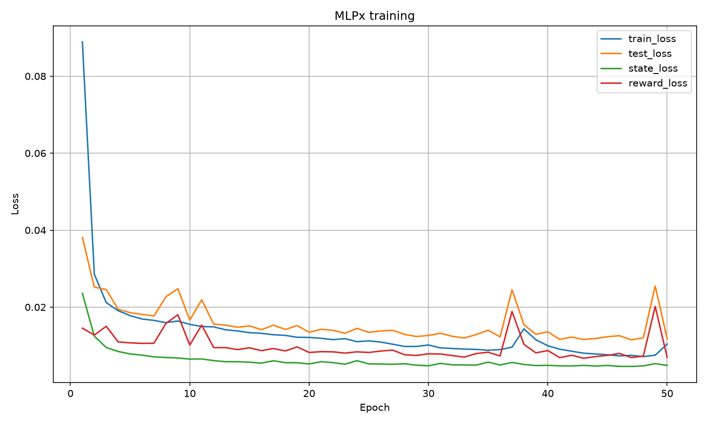

# Training

*Experiment 1 · End-to-end baseline training*

## Dataset pipeline

The training data combines two sources:

1. Intent-aware records, where the ego can request messages from visible vehicles.
2. Random no-message records, where the ego requests nothing and takes random actions.

The merged file is `data/combined_world_model_dataset.jsonl`.

## Experiment phases

The current checkpoints and graphs represent the **first baseline training
experiment**:

1. Train MLPx on the initial 26,597-transition merged dataset.
2. Freeze that MLPx checkpoint.
3. Train the Request DQN for 1,000 episodes while the frozen MLPx planner
   chooses ego driving actions.

These results are useful for measuring the pipeline, but they are not treated
as final performance. The next phase is to collect more diverse episodes,
retrain MLPx, freeze the improved checkpoint, and then retrain the Request DQN
against it.

## Train MLPx

```bash
.venv/bin/python -m scripts.training.train_mlpx_wm \
  --data data/combined_world_model_dataset.jsonl \
  --epochs 50 \
  --batch-size 128 \
  --lr 1e-3
```

The best checkpoint is saved to `checkpoints/MLPx/best.pt`. Training uses next-state MSE and reward MSE. Episodes, rather than individual transitions, determine the held-out split to reduce leakage between train and test data.

## Train the request DQN

The request DQN learns which spatial vehicle slot to ask, or whether to ask nobody. The frozen MLPx planner then chooses the ego driving action using a three-step horizon.

```bash
.venv/bin/python -m scripts.training.train_request_dqn \
  --episodes 1000 \
  --planning-horizon 3 \
  --communication-cost 0.05 \
  --output checkpoints/RequestDQN/best.pt
```

The request actions are the eight visible spatial slots plus `ask nobody`. The DQN reward is the real driving reward minus the communication cost when it asks a vehicle.

Each run writes a CSV log under `results/RequestDQN/experiments/<timestamp>/request_dqn_training.csv` with episode return, mean loss, epsilon, request count, crash, and truncation columns. Use `--log-path PATH` to choose a different location.

## Training graphs

### MLPx



### Request DQN


## Current evaluation

The current checkpoint achieved held-out one-step metrics of next-state RMSE `0.0677` and reward RMSE `0.0828`. In open-loop evaluation, state RMSE was `0.0935` after three steps and `0.1201` after five steps on random no-message sequences.

The real-rollout comparison shows the same horizon effect: three-step reward
MAE is `0.336` without messages and `0.383` with all visible messages, while
five-step reward MAE is `0.723` and `0.635`, respectively. MLPx matched the
real environment's best action `66.7%` of the time at three steps without
messages, versus `23.1%` at five steps.

The DQN baseline currently shows improving return but unstable learning loss
and frequent crashes. It should therefore be compared with future runs using
the same validation seeds, rather than treated as a finished policy.

Older experiment outputs are stored under `results/archive/`. The active run is `results/MLPx/experiments/20261119_110113_mlpx`.
