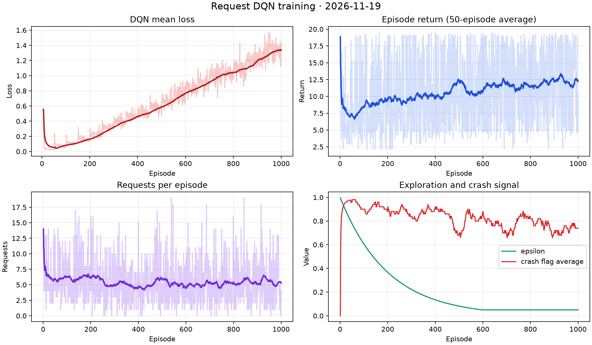
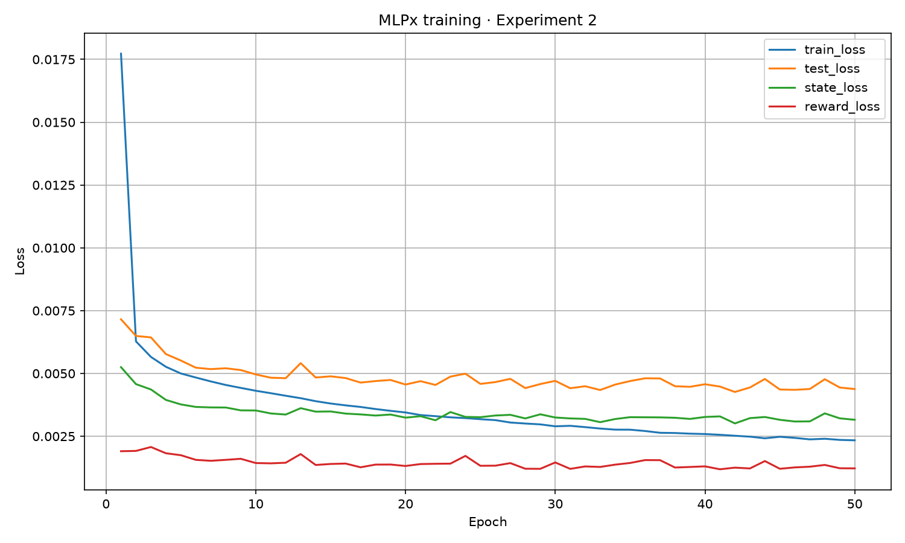
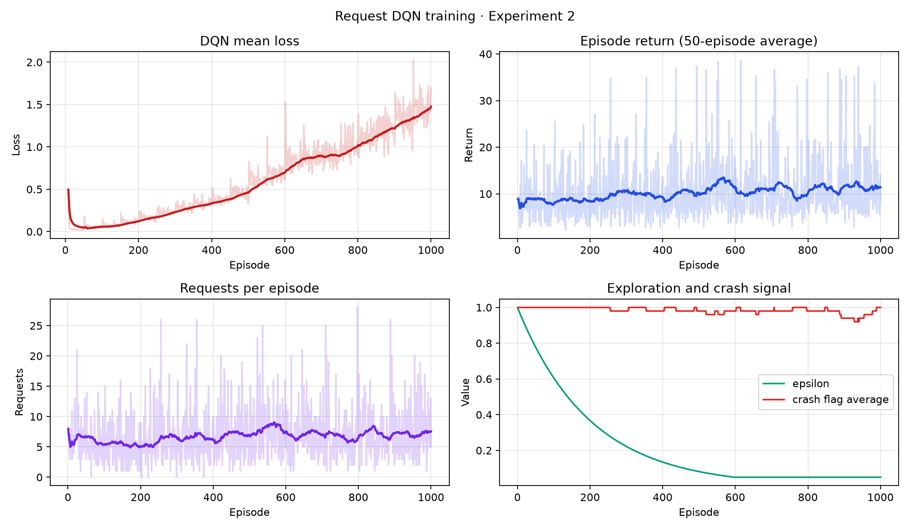

# Training

## Dataset pipeline

The training data combines two sources:

1. Intent-aware records, where the ego can request messages from visible vehicles.
2. Random no-message records, where the ego requests nothing and takes random actions.

Each experiment uses `data/experiment_N/combined_world_model_dataset.jsonl`.
All collection, training, evaluation, and rendering scripts accept the same
`--experiment N` option, which keeps the corresponding data, checkpoints, and
results together.

## Experiment 1 · End-to-end baseline training

The checkpoints and graphs below represent the **first baseline training
experiment**:

1. Train MLPx on the initial 26,597-transition merged dataset.
2. Freeze that MLPx checkpoint.
3. Train the Request DQN for 1,000 episodes while the frozen MLPx planner
   chooses ego driving actions.

These results establish the baseline. Experiment 2 repeats this sequence with
a larger dataset, as documented below.

### Train MLPx

```bash
.venv/bin/python -m scripts.training.train_mlpx_wm \
  --experiment 1 \
  --epochs 50 \
  --batch-size 128 \
  --lr 1e-3
```

The best checkpoint is saved to `checkpoints/experiment_1/MLPx/best.pt`. Training uses next-state MSE and reward MSE. Episodes, rather than individual transitions, determine the held-out split to reduce leakage between train and test data.

### Train the request DQN

The request DQN learns which spatial vehicle slot to ask, or whether to ask nobody. The frozen MLPx planner then chooses the ego driving action using a three-step horizon.

```bash
.venv/bin/python -m scripts.training.train_request_dqn \
  --experiment 1 \
  --episodes 1000 \
  --planning-horizon 3 \
  --communication-cost 0.05
```

The request actions are the eight visible spatial slots plus `ask nobody`. The DQN reward is the real driving reward minus the communication cost when it asks a vehicle.

Each run writes a CSV log under `results/experiment_1/RequestDQN/experiments/<timestamp>/request_dqn_training.csv` with episode return, mean loss, epsilon, request count, crash, and truncation columns. Use `--log-path PATH` to choose a different location.

### Training graphs

#### MLPx


#### Request DQN



### Experiment 1 evaluation

The current checkpoint achieved held-out one-step metrics of next-state RMSE `0.0677` and reward RMSE `0.0828`. In open-loop evaluation, state RMSE was `0.0935` after three steps and `0.1201` after five steps on random no-message sequences.

The real-rollout comparison shows the same horizon effect: three-step reward
MAE is `0.336` without messages and `0.383` with all visible messages, while
five-step reward MAE is `0.723` and `0.635`, respectively. MLPx matched the
real environment's best action `66.7%` of the time at three steps without
messages, versus `23.1%` at five steps.

The DQN baseline currently shows improving return but unstable learning loss
and frequent crashes. It should therefore be compared with future runs using
the same validation seeds, rather than treated as a finished policy.

### Model evaluation scripts

MLPx rollout accuracy:

```bash
.venv/bin/python -m scripts.evaluation.evaluate_mlpx_rollout \
  --experiment 1 --episodes 10 --states-per-episode 3
```

Request-policy validation:

```bash
.venv/bin/python -m scripts.evaluation.evaluate_request_dqn \
  --experiment 1 --episodes 200 --planning-horizon 3
```

Both evaluators write their metrics under the selected experiment's
`results/experiment_N/evaluation/` directory.

The Experiment 1 MLPx run is `results/experiment_1/MLPx/experiments/20261119_110113_mlpx`.

## Experiment 2 · Larger dataset training

MLPx training, Request DQN training, and both evaluations are complete.
The sequence is to train MLPx, freeze its best checkpoint, and train the DQN
with that checkpoint providing the driving planner's predictions.

### Dataset

| Source | Records | Source episodes |
| --- | ---: | ---: |
| Intent-aware policy | `197,553` | `1,000` |
| Random no-message | `25,822` | `1,000` |
| Combined | `223,375` | `2,000` |

The merged training input is
`data/experiment_2/combined_world_model_dataset.jsonl`. It contains 526 crash
transitions. The intent-aware collection completed 40,000 actual rollout
steps across 1,000 episodes, or 40 steps per episode at one decision per second.
See the [dataset dashboard](dataset_dashboard.html) for source statistics.

### Train MLPx

```bash
.venv/bin/python -m scripts.training.train_mlpx_wm \
  --experiment 2 \
  --epochs 50 \
  --batch-size 128 \
  --lr 1e-3
```

Training minimizes next-state MSE plus reward MSE using Adam. Episode groups
determine the train/test split. The lowest recorded test loss was `0.004263`
at epoch `42`: state MSE `0.003011` and reward MSE `0.001252`.

The selected checkpoint is `checkpoints/experiment_2/MLPx/best.pt`.
Training logs and the loss graph are stored in
`results/experiment_2/MLPx/experiments/20261119_165206_mlpx/`.

#### MLPx training graphs



The chart uses the same four curves as Experiment 1: training total loss,
test total loss, test state loss, and test reward loss.

### Evaluate MLPx

```bash
.venv/bin/python -m scripts.evaluation.evaluate_mlpx_rollout \
  --experiment 2 \
  --episodes 10 \
  --states-per-episode 3
```

| Horizon | Messages | Valid states | State MAE | Cumulative reward MAE | Best-action agreement |
| --- | --- | ---: | ---: | ---: | ---: |
| 3 steps | None | `29` | `0.0213` | `0.0422` | `96.55%` |
| 3 steps | All visible | `29` | `0.0574` | `0.1777` | `68.97%` |
| 5 steps | None | `11` | `0.0385` | `0.1603` | `54.55%` |
| 5 steps | All visible | `11` | `0.0749` | `0.2336` | `63.64%` |

These are short-rollout results on normalized states. The evaluator excludes
cases where any candidate action terminates before the requested horizon,
so these metrics do not establish prediction accuracy near collisions.
See [MLPx results](mlpx.html) for the model discussion.

### Train the request DQN

```bash
.venv/bin/python -m scripts.training.train_request_dqn \
  --experiment 2 \
  --episodes 1000 \
  --planning-horizon 3 \
  --communication-cost 0.05
```

The Experiment 2 MLPx checkpoint stays frozen during DQN training.

| Training metric | Result |
| --- | ---: |
| Episodes | `1,000` |
| Mean return | `10.263` |
| Last 100 episodes: mean return | `11.423` |
| Mean loss | `0.618` |
| Last 100 episodes: mean loss | `1.407` |
| Mean requests per episode | `6.749` |
| Episodes with crash flag | `984` (`98.40%`) |
| Episodes with truncation flag | `16` (`1.60%`) |
| Final epsilon | `0.05` |

The checkpoint is `checkpoints/experiment_2/RequestDQN/best.pt`.
The training CSV is stored in
`results/experiment_2/RequestDQN/experiments/20261119_170031_request_dqn/`.

#### Request DQN training graphs



Faint curves show individual episodes; solid curves show trailing averages
over up to 50 episodes. As in Experiment 1, the panels show loss, return,
requests, and exploration epsilon alongside the average crash flag (0–1).
Loss is absent during the initial replay warmup.
These curves describe exploratory training, rather than the fixed-seed
evaluation below.

Regenerate the Experiment 2 documentation graphs from the latest training logs:

```bash
.venv/bin/python -m scripts.docs.plot_training_graphs --experiment 2
```

### Evaluate the request DQN

```bash
.venv/bin/python -m scripts.evaluation.evaluate_request_dqn \
  --experiment 2 \
  --episodes 200 \
  --planning-horizon 3
```

| Request policy | Mean return | Mean driving reward | Mean requests | Crash rate |
| --- | ---: | ---: | ---: | ---: |
| DQN | `12.326` | `12.556` | `4.615` | `94.50%` |
| Ask nobody | `11.973` | `11.973` | `0.000` | `93.00%` |
| Random requests | `7.692` | `8.144` | `9.050` | `99.50%` |
| Ask all visible | `6.855` | `7.705` | `16.985` | `100.00%` |

Return includes communication cost; driving reward excludes it. The DQN has
a small average return advantage over asking nobody, but a higher crash rate.
Full-episode safety therefore remains unresolved despite the promising
short-rollout World Model metrics.

Both evaluators save CSV and JSON artifacts under
`results/experiment_2/evaluation/`. See the [DQN policy page](dqn_policy.html)
for the detailed comparison and Experiment 2 rendering.

Older experiment outputs are stored under `results/archive/`.
